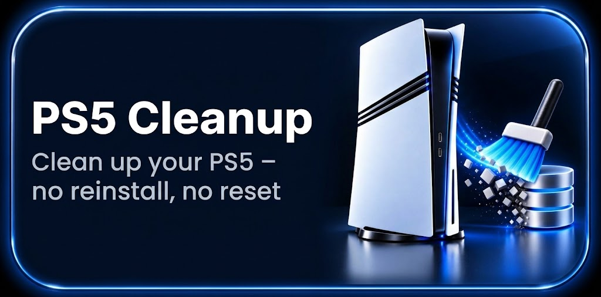
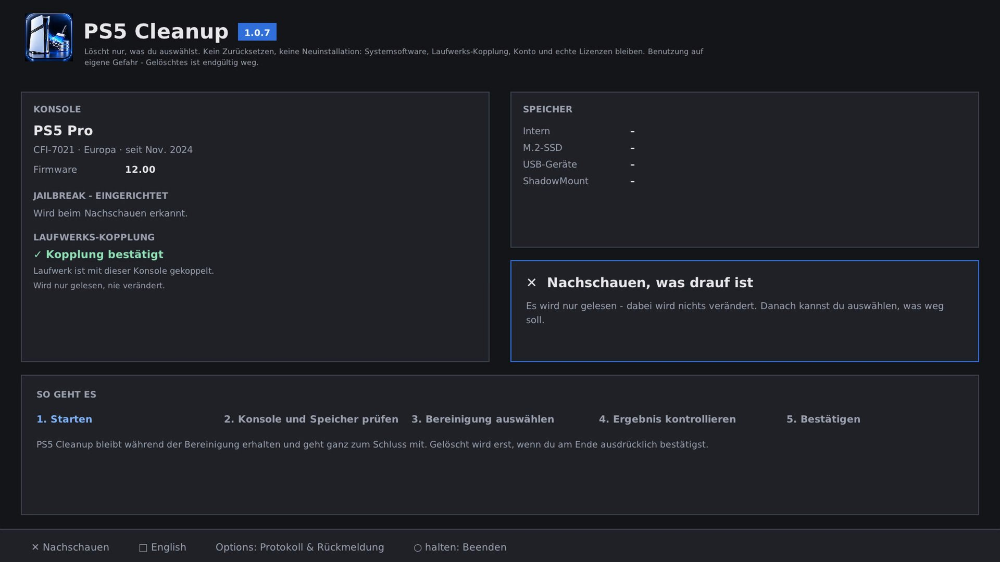
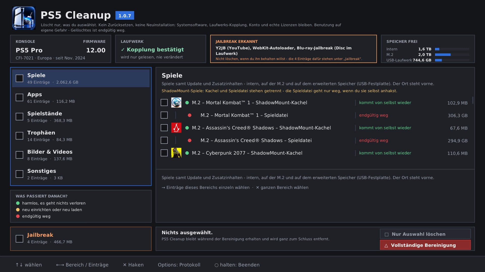
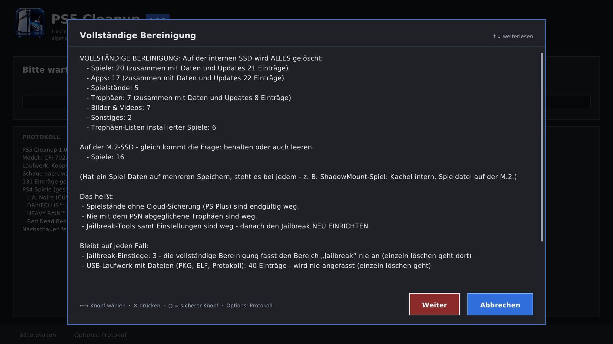
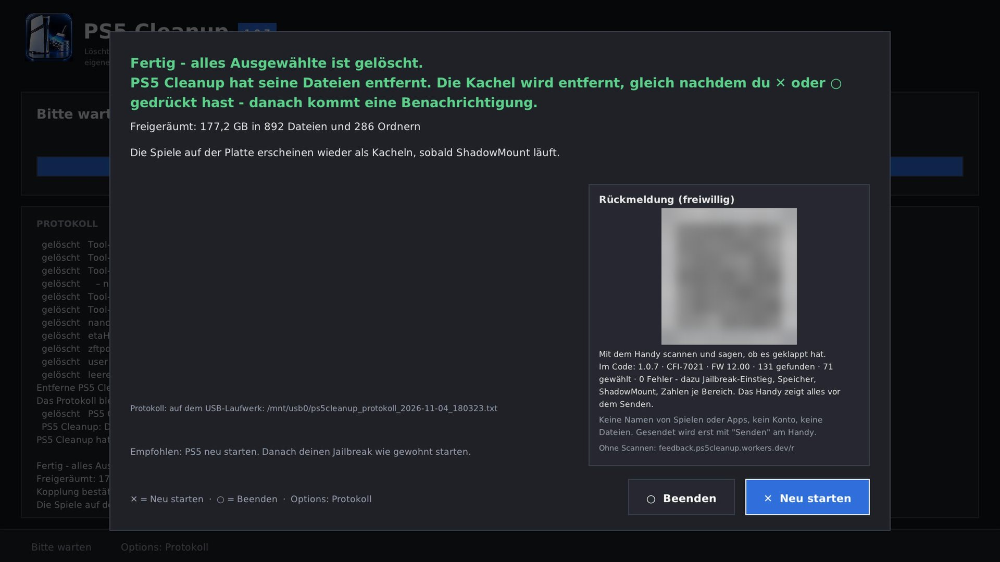

**Deine PS5 aufräumen wie frisch eingerichtet – ohne Neuinstallation, ohne Zurücksetzen.**

   

### [⬇️ PS5 Cleanup 1.0.7 herunterladen](https://github.com/xXBneutzerNameXx/PS5-Cleanup/releases/latest)

[So geht's](#so-gehts) · [Was es kann](#was-es-kann) · [Rückmeldung](#rückmeldungen) · [Community](#community) · [**🇬🇧 English**](#english)

## Auf einen Blick

| 🧹 Sauber | 🛡️ Sicher | 🎮 Direkt am Fernseher |
|---|---|---|
| Kacheln, Apps und Spiele trägt Sony selbst aus – keine leeren Kacheln, kein Datenbank-Neuaufbau | Jailbreak-Einstiege und PS4-Spiele sind geschützt. Gelöscht wird erst nach deiner Bestätigung | Eigene Kachel, Bedienung mit dem Controller – kein PC, kein FTP, kein USB-Laufwerk nötig |
| **📦 Ein Block pro App** | **🧪 Test-Fassung** | **📱 Rückmeldung per QR-Code** |
| Kachel oben, darunter alles, was dazugehört – zugeordnet nur mit Beleg, geraten wird nie | `PS5-Cleanup-Test_v1.0.7.elf` zeigt alles an wie die echte App und kann technisch nichts löschen | Mit dem Handy scannen, ohne Konto, ohne persönliche Daten |

<b>📸 So sieht's aus</b> (Bilder von der PS5, zum Aufklappen)

 

<table>
<tr>
<td width="50%"></td>
<td width="50%"></td>
</tr>
<tr>
<td><b>1. Start:</b> Konsole, Firmware, Jailbreak und Laufwerks-Kopplung auf einen Blick. Nachschauen ändert nichts.</td>
<td><b>2. Auswahl:</b> Links die Bereiche, rechts jeder Eintrag mit Größe und einer Farbe dafür, was danach passiert.</td>
</tr>
<tr>
<td width="50%"></td>
<td width="50%"></td>
</tr>
<tr>
<td><b>3. Vollständige Bereinigung:</b> Vorher steht genau da, was gelöscht wird und was auf jeden Fall bleibt.</td>
<td><b>4. Fertig:</b> Freigeräumter Platz, Protokoll auf dem USB-Stick und QR-Code für die Rückmeldung.</td>
</tr>
</table>

### 🗳️ PS5 Cleanup Community – Deine Meinung zählt!

**Welche PS5 nutzt du?** Hilf uns, PS5 Cleanup für verschiedene Konsolen und Firmware-Versionen zu verbessern!

[**🗳️ Jetzt abstimmen**](https://github.com/xXBneutzerNameXx/PS5-Cleanup/discussions/4) · [**💬 Diskussionen & Vorschläge**](https://github.com/xXBneutzerNameXx/PS5-Cleanup/discussions) · [**🎮 Kompatibilität melden**](https://github.com/xXBneutzerNameXx/PS5-Cleanup/discussions/categories/compatibility)

## ⚠️ Welche Datei ist was? Bitte zuerst lesen!

| Datei | Wofür | Löscht? |
|---|---|---|
| **`ps5cleanup_v1.0.7.elf`** | **PS5-App** – läuft direkt auf der PS5, Bedienung mit dem Controller | **Ja!** Erst nach deiner ausdrücklichen Bestätigung |
| **`PS5-Cleanup-Test_v1.0.7.elf`** | **PS5-App zum gefahrlosen Ausprobieren** (z. B. auf einer neuen Firmware) – zeigt alles an wie die echte App, oben steht „TEST“ | **Nein! Kann technisch nichts löschen** |
| **`PS5-Cleanup-1.0.7.zip`** | beide ELF-Dateien + Anleitungen + Prüfsummen | – |

> [!TIP]
> **Unsicher, anderes Modell oder andere Firmware? Nimm zuerst die Test-Datei!** Sie zeigt dir genau, was die echte App anbieten würde – ohne jedes Risiko.

> [!WARNING]
> **Kein „Datenbank neu aufbauen“ mehr:** Sonys „Datenbank neu aufbauen“ (abgesicherter Modus) löscht installierte **PS4-Spiele aus Fake-PKGs** auf der internen SSD und auf dem erweiterten Speicher (USB-Festplatte). Die PKG-Dateien bleiben, die Spiele müssen aber neu installiert werden (beobachtet am 31.10.2026 auf einer PS5 Pro mit Firmware 12.00; andere Tools wie elf-arsenal und ps5-db-backup beschreiben dasselbe). Frühere Fassungen dieser Anleitung haben den Neuaufbau empfohlen – **bitte nicht mehr machen.** Ab 1.0.7 ist er auch nicht mehr nötig. Was sich nicht sauber entfernen lässt, nennt PS5 Cleanup am Ende und lässt es unverändert. Bleibt trotzdem eine leere Kachel stehen, schick uns bitte das Protokoll (siehe [Rückmeldungen](#rückmeldungen)). **Nie** „PS5 zurücksetzen“ oder „Systemsoftware neu installieren“ wählen.

> [!NOTE]
> **Keine Windows-Fassung mehr:** Ab 1.0.7 gibt es keine `PS5-Cleanup.exe` mehr – [warum, steht unten](#warum-keine-windows-fassung-mehr).

<b>✨ Neu in 1.0.7 – aufräumen in einem Rutsch, ohne leere Kacheln, ohne leere Einträge und ohne Datenbank-Neuaufbau</b> (zum Aufklappen)

 

Getestet vom 01. bis 03.11.2026 auf einer PS5 Pro mit Firmware 12.00, M.2, mit und ohne USB-Laufwerk:

- Apps, Tool-Kacheln und Spiele trägt Sony selbst aus – auch PS4-Spiele aus Fake-PKGs, ShadowMount-Kacheln und Spiele, die als Ordner auf der M.2 liegen. Die Daten einer App gehen mit ihrer Kachel, nichts wird halb gelöscht.
- Spiele, die sich im PS5-Menü nicht löschen lassen (kaputte Zusatzinhalt-Angaben, z. B. aus einem umgebauten Patch): PS5 Cleanup repariert sie vorher selbst, danach trägt Sony das Spiel sauber aus. Solche Spiele erkennt es schon beim Nachschauen („ACHTUNG: kaputte Zusatzinhalt-Angaben“).
- **Neu: freiwillige Rückmeldung per QR-Code** – mit dem Handy scannen, ohne Konto, ohne persönliche Daten (siehe [Rückmeldungen](#rückmeldungen)).
- **Jede App und jedes Tool als ein Block:** oben die Kachel, darunter Daten- und Einstellungsordner, Dateien auf M.2 und USB-Laufwerk, ELF- und PKG-Dateien. Neu: PS5 Cleanup schaut auch in das Programm der App selbst – nennt es einen Ordner (z. B. `/data/PCSX2`), gehört er zu ihr. Das klappt auch bei Tools, die PS5 Cleanup nicht kennt. Ohne sicheren Beleg bleibt ein Eintrag unter Sonstiges – geraten wird nie.
- **Trophäen je Spiel als ein Block:** oben die Trophäen-Liste, darunter der Fortschritt aller Konten.
- **Wichtige Tool-Daten rot:** Ordner mit eigenen Spielen, Spielständen oder Sicherungen (z. B. roms, saves, keys oder Speicherkarten eines Emulators) stehen rot da, mit Hinweis, was gefunden wurde.
- **Namen auch für Reste:** Spielstände, Trophäen, Lizenzen und Aufnahmen tragen den Namen ihres Spiels – auch wenn es schon gelöscht ist. Ohne Beleg steht „Spiel/App unbekannt“ da.
- Bilder und Videos über Sonys eigenen Löschdienst, Spielstände samt Eintrag in Sonys Spielstand-Liste – keine leeren Einträge.
- Kein USB-Laufwerk nötig, keine Datenbank-Sicherungen mehr. Das Protokoll landet auf dem USB-Laufwerk, wenn eins steckt. Fehlt es oder ist es voll oder nicht beschreibbar, kommt es auf die interne Platte (`/data/PS5-Cleanup-Protokolle/`), ist die auch voll, auf die M.2 (`PS5-Cleanup-Protokolle/`). Jeder Lauf bekommt eine eigene Datei. Die vollständige Bereinigung räumt alte Protokolle auf der internen Platte mit weg, die auf dem USB-Laufwerk und der M.2 bleiben.
- Am Ende: ✕ Neu starten (empfohlen) oder ○ Beenden.
- Neue Oberfläche am Fernseher: 7 Bereiche, Kachelbilder, Apps wie Spiele zusammengefasst, Updates und Zusatzinhalte direkt unter ihrem Spiel, zu jedem Eintrag „Was ist das? / Was wird gelöscht? / Was passiert danach?“.

Getestet auf einer PS5 Pro (CFI-7021) mit Firmware 12.00 und M.2. Andere Modelle und Firmwares sind nicht gesperrt, aber noch nicht getestet – dort bitte zuerst `PS5-Cleanup-Test_v1.0.7.elf` starten und schauen, ob die Liste stimmt. [Alle Neuerungen](https://github.com/xXBneutzerNameXx/PS5-Cleanup/releases)

## Worum geht's?

Wer seine PS5 mit Jailbreak eine Weile nutzt, kennt das: tote Kacheln, Reste gelöschter Spiele, alte Downloads, Fehlerberichte, Daten von Tools, die man längst nicht mehr nutzt. Die Systemsoftware neu aufspielen will man deswegen aber nicht – erst recht nicht bei Slim und Pro, wo dabei die Laufwerks-Kopplung verloren gehen kann.

**PS5 Cleanup** läuft direkt auf der PS5, listet alles übersichtlich mit Namen auf und löscht nur das, was du auswählst.

**Zwei Wege:**
- **Gezielt** – einzelne Einträge anhaken, z. B. wenn ein Spiel oder Tool Probleme macht: nur dessen Daten, Spielstand oder Trophäen löschen, der Rest bleibt.
- **Vollständige Bereinigung** – alles auf der internen SSD auf einmal, wie frisch eingerichtet (die M.2 wird extra gefragt, Bestätigung mit `LÖSCHEN`).

## Was es kann

- **Eigene Kachel** auf dem Startbildschirm, Bedienung mit dem Controller am Fernseher – kein PC, kein Homebrew Launcher nötig
- **Kacheln verschwinden sauber** über Sonys eigenen Deinstallations-Dienst, **Bilder und Videos** über Sonys Löschdienst, **Spielstände** samt Eintrag in Sonys Spielstand-Liste
- **Jailbreak-Schutz:** YouTube (Y2JB), Netflix ('N Hack), Lua-Spiele, PS2-Spielstand-Jailbreak und offline gespeicherter WebKit-Jailbreak werden erkannt, nie automatisch angehakt und vor dem Löschen deutlich gewarnt
- **Übersicht auf einen Blick:** Modell, Firmware, eingerichtete Jailbreak-Einstiege, Laufwerks-Kopplung und freier Speicher
- **Ein Block pro App und Spiel:** Kachel oben, darunter alles, was dazugehört – zugeordnet nur mit Beleg (Kennung, Name oder das Programm der App selbst)
- **Klarnamen und Kachelbilder** in 7 Bereichen: Spiele (PS5 und PS4) mit **Update und DLCs einzeln wählbar**, Apps, Spielstände, Trophäen, Bilder & Videos, Sonstiges, Jailbreak
- **M.2: jedes Spiel und jede Datei einzeln** – die Ordner selbst bleiben stehen, für M.2 und erweiterten Speicher gibt es eine eigene Rückfrage
- **Größe jedes Eintrags direkt in der Liste** (wird im Hintergrund gezählt)
- **ShadowMount-Spiele:** wahlweise nur die Kachel oder Spiel samt Kachel – ShadowMount+ wird vorher sauber angehalten
- **Nachschauen und Anhaken löscht nichts** – gelöscht wird erst nach ausdrücklicher Bestätigung
- **Protokoll** jederzeit mit Options; beim Löschen zusätzlich als Datei auf dem USB-Laufwerk, sonst auf der internen Platte oder der M.2
- **Am Ende:** ✕ Neu starten (empfohlen) oder ○ Beenden
- **Deutsch und Englisch** – richtet sich nach der Systemsprache der PS5, Quadrat schaltet vor dem ersten Nachschauen um

## Was das Programm nicht anfasst

Systemsoftware, Laufwerks-Kopplung, Benutzerkonto, Aktivierung, echte Lizenzen und die Sony-Systemanwendungen. Es wird nichts installiert und nichts zurückgesetzt. Sonys Datenbanken ändert die PS5-App nur gezielt: die Einträge gelöschter Spielstände und kaputte Zusatzinhalt-Angaben eines Spiels, das du löschst. Jede dieser Änderungen wird vorher geprüft und ganz oder gar nicht gemacht.

## Voraussetzungen

- PS5 mit Jailbreak und einem Payload-Lader oder dem Payload Manager
- Kein PC, kein FTP und kein USB-Laufwerk nötig

## So geht's

1. Jailbreak laden, `ps5cleanup_v1.0.7.elf` aus den [Releases](https://github.com/xXBneutzerNameXx/PS5-Cleanup/releases/latest) über den Payload-Lader oder den Payload Manager starten. Steckt ein USB-Laufwerk, kommt das Protokoll darauf. Unsicher? Erst `PS5-Cleanup-Test_v1.0.7.elf` – sie löscht nichts.
2. **Nachschauen**, dann einzelne Einträge anhaken (Quadrat = **Nur Auswahl löschen**) oder Dreieck = **Vollständige Bereinigung**.
3. Am Ende **✕ Neu starten** (empfohlen) oder **○ Beenden**. Nach dem Neustart den Jailbreak wie gewohnt starten.
   **Kein** „Datenbank neu aufbauen“ (löscht installierte PS4-Spiele, siehe Warnung oben). **Nie** „PS5 zurücksetzen“ oder „Systemsoftware neu installieren“ wählen!

Ausführliche Anleitung: [LIESMICH.txt](LIESMICH.txt) · English: [README_EN.txt](README_EN.txt)

## Rückmeldungen

**Am einfachsten per QR-Code:** Am Ende und in der Protokoll-Ansicht (Options) zeigt PS5 Cleanup einen QR-Code. Mit dem Handy scannen, auf „Hat geklappt“ oder „Problem“ tippen – ohne Konto, ohne PC. Die PS5 sendet dabei nichts.

Im Link stehen nur Version, Fassung, Bau-Stempel, Modellnummer, Firmware, Laufwerks-Kopplung, eingerichtete Jailbreak-Einstiege, angeschlossene Speicher, ShadowMount, Zahlen je Bereich und bei Fehlern kurze Fehlercodes (Schritt, Art des Eintrags, Ort, Code) – **keine Namen von Spielen oder Apps, keine Spielkennungen, kein Konto, keine Dateien, keine IP der PS5**. Dieselben Angaben stehen in Klartext daneben und noch einmal auf dem Handy; gespeichert wird erst mit „Senden“. Wie bei jedem Webseitenaufruf sieht der Server kurz die Internet-Adresse des Handys – sie wird nicht gespeichert. Die Seite läuft bei Cloudflare unter `feedback.ps5cleanup.workers.dev` ([Datenschutz-Hinweis](https://feedback.ps5cleanup.workers.dev/datenschutz)).

Ausführlicher: Über [Issues](https://github.com/xXBneutzerNameXx/PS5-Cleanup/issues), die [Discussions](https://github.com/xXBneutzerNameXx/PS5-Cleanup/discussions) (Modell, Firmware und Ergebnis gern unter [Compatibility](https://github.com/xXBneutzerNameXx/PS5-Cleanup/discussions/categories/compatibility)) oder auf psxtools.de – am besten mit dem **Protokoll**. Das geht auch ohne etwas zu löschen: In der Protokoll-Ansicht (Options) speichert Quadrat es auf das USB-Laufwerk (nur `ps5cleanup_v1.0.7.elf` – die Test-Datei speichert nichts, dort die Protokoll-Ansicht einfach abfotografieren).

## Warum keine Windows-Fassung mehr?

Zum Aufklappen

 

- Die Windows-Fassung arbeitet über FTP. Über FTP lassen sich Kacheln und die Einträge in Mediengalerie und Spielstand-Liste nicht sauber austragen – genau das macht 1.0.7 aus. Sie hätte also nur halb aufräumen können: Leere Kacheln und leere Einträge wären geblieben.
- Wer auf der PS5 einen FTP-Server starten kann, kann dort genauso die PS5-App starten. Sie kann alles, was die Windows-Fassung konnte, und mehr.
- Geplant für die nächste Version: PS5 Cleanup auch vom PC oder Handy aus über den Browser bedienen, wie es inzwischen viele PS5-Tools anbieten (z. B. ShadowMount oder der Payload Manager).
- Der Quellcode der bisherigen Windows-Fassung (1.0.6) bleibt im Ordner `Quellcode/`, wird aber nicht weiterentwickelt.

## Aufbau

Ordner im Quellcode (zum Aufklappen)

 

| Ordner | Inhalt |
|---|---|
| `1.0.7/kern/` | Kern der PS5-App: Schutzliste, Suche, Löschen, Abläufe |
| `1.0.7/app/` | Oberfläche am Fernseher (SDL2, DualSense) und PS5-Anbindung (Sony-Deinstallation, Löschdienst, Spielstand-Liste) |
| `1.0.7/start/` | `ps5cleanup.elf`: Start, eigene Kachel (PSCL00001), Hintergrundteil für Selbstentfernung und Neustart |
| `1.0.7/db/` | Prüfung von Sonys Datenbanken (SQLite) |
| `1.0.7/rueckmeldung/` | Handy-Seite für die Rückmeldung per QR-Code (Cloudflare Worker) |
| `1.0.7/test/` | Tests am PC |
| `1.0.7/fremd/` | Anleitung und Skript für die fremden Bibliotheken (PCRE2, cJSON) |
| `Quellcode/` | die bisherige Windows-Fassung 1.0.6 (C#) und ältere Fassungen – nicht mehr weiterentwickelt |

## Lizenz

Die PS5-App (`1.0.7/`, `ps5cleanup_v1.0.7.elf`, `PS5-Cleanup-Test_v1.0.7.elf`) steht unter der GPL-3.0 (oder später) – Copyright (c) 2026 da_Chris86. Der Code der bisherigen Windows-Fassung steht unter MIT. Details und Bestandteile anderer Urheber in [LICENSE.txt](LICENSE.txt).

## Danke an

[drakmor](https://github.com/drakmor) (ftpsrv, ps5-hwinfo), [earthonion](https://github.com/earthonion) (ddd_status), John Törnblom (ps5-payload-sdk, ftpsrv), [seregonwar](https://github.com/seregonwar) (zftpd), die Macher von ShadowMountPlus und PS5Upload, [Project Nayuki](https://www.nayuki.io/page/qr-code-generator-library) (QR-Code-Bibliothek) sowie Markus Scholtes (PS2EXE).

Entwickelt von da_Chris86 mit Claude (Anthropic). Unabhängige Code-Prüfung: OpenAI Codex. Idee, Vorgaben und die Tests an der echten Konsole kommen von mir.

**Benutzung auf eigene Gefahr – Gelöschtes ist endgültig weg.**
Inoffizielles Community-Projekt, keine Verbindung zu Sony. PlayStation und PS5 sind Marken von Sony Interactive Entertainment Inc.

---

## English

<b><a href="https://github.com/xXBneutzerNameXx/PS5-Cleanup/releases/latest">⬇️ Download PS5 Cleanup 1.0.7</a></b>

### At a glance

| 🧹 Clean | 🛡️ Safe | 🎮 Right on your TV |
|---|---|---|
| Tiles, apps and games are removed by Sony itself – no empty tiles, no database rebuild | Jailbreak entry points and PS4 games are protected. Nothing is deleted until you confirm | Own home-screen tile, controlled with the controller – no PC, no FTP, no USB drive needed |
| **📦 One block per app** | **🧪 Test version** | **📱 Feedback via QR code** |
| The tile at the top, everything that belongs to it below – assigned only with evidence, nothing is ever guessed | `PS5-Cleanup-Test_v1.0.7.elf` shows everything like the real app and technically cannot delete anything | Scan with your phone, no account, no personal data |

<b>📸 What it looks like</b> (screenshots from the PS5, click to expand)

 

<table>
<tr>
<td width="50%"></td>
<td width="50%"></td>
</tr>
<tr>
<td><b>1. Start:</b> Console, firmware, jailbreak and drive pairing at a glance. Scanning changes nothing.</td>
<td><b>2. Selection:</b> Areas on the left, every entry on the right with its size and a color for what happens afterwards.</td>
</tr>
<tr>
<td width="50%"></td>
<td width="50%"></td>
</tr>
<tr>
<td><b>3. Full cleanup:</b> Before anything happens, it lists exactly what will be deleted and what always stays.</td>
<td><b>4. Done:</b> Space freed, log on the USB drive and a QR code for feedback.</td>
</tr>
</table>

The screenshots show the German interface. The app also runs in English (switch it on the start screen).

### 🗳️ PS5 Cleanup Community – Your Feedback Matters!

**Which PS5 do you own?** Help us improve PS5 Cleanup across different console models and firmware versions!

[**🗳️ Vote in our poll**](https://github.com/xXBneutzerNameXx/PS5-Cleanup/discussions/4) · [**💬 Join discussions**](https://github.com/xXBneutzerNameXx/PS5-Cleanup/discussions) · [**🎮 Report compatibility**](https://github.com/xXBneutzerNameXx/PS5-Cleanup/discussions/categories/compatibility)

### ⚠️ Which file is which? Please read first!

| File | What for | Deletes? |
|---|---|---|
| **`ps5cleanup_v1.0.7.elf`** | **PS5 app** – runs directly on the PS5, controlled with the DualSense | **Yes!** Only after you explicitly confirm |
| **`PS5-Cleanup-Test_v1.0.7.elf`** | **PS5 app for trying it out safely** (e.g. on a new firmware) – shows everything like the real app, "TEST" at the top | **No! Technically cannot delete anything** |
| **`PS5-Cleanup-1.0.7.zip`** | both ELF files + guides + checksums | – |

> [!TIP]
> **Not sure, other model or other firmware? Start with the test file!** It shows exactly what the real app would offer – without any risk.

> [!WARNING]
> **No more "Rebuild Database":** Sony's "Rebuild Database" (Safe Mode) deletes installed **PS4 games from fake PKGs** on the internal SSD and on the extended storage (USB hard drive for games). The PKG files stay, but the games have to be installed again (observed on 31 Oct 2026 on a PS5 Pro with firmware 12.00; other tools such as elf-arsenal and ps5-db-backup describe the same). Earlier versions of this guide recommended the rebuild – **please do not do it any more.** From 1.0.7 on it is not needed either. Whatever cannot be removed cleanly is named at the end and left unchanged. If an empty tile still stays, please send us the log (see *Feedback* below). **Never** choose "Reset PS5" or "Reinstall System Software".

> [!NOTE]
> **No Windows version any more:** from 1.0.7 on there is no `PS5-Cleanup.exe` – see *Why no Windows version any more?* below.

<b>✨ New in 1.0.7 – cleaning up in one go, without empty tiles, without empty entries and without a database rebuild</b> (click to expand)

 

Tested from 1 to 3 Nov 2026 on a PS5 Pro with firmware 12.00, M.2, with and without USB drive:

- Apps, tool tiles and games are removed by Sony itself – including PS4 games from fake PKGs, ShadowMount tiles and games stored as folders on the M.2. An app's data goes with its tile, nothing is half deleted.
- Games that cannot be deleted in the PS5 menu (broken add-on information, e.g. from a modified patch): PS5 Cleanup repairs them first, then Sony removes the game cleanly. It already detects such games while scanning ("WARNING: broken add-on entries").
- **New: optional feedback via QR code** – scan with your phone, no account, no personal data.
- **Every app and every tool as one block:** the tile at the top, below it data and settings folders, files on the M.2 and the USB drive, ELF and PKG files. New: PS5 Cleanup also looks into the app's own program – if it names a folder (e.g. `/data/PCSX2`), it belongs to that app. This also works for tools PS5 Cleanup does not know. Without solid evidence an entry stays under Other – nothing is ever guessed.
- **Trophies as one block per game:** the trophy list at the top, below it the progress of all accounts.
- **Important tool data in red:** folders with your own games, saves or backups (e.g. roms, saves, keys or an emulator's memory cards) are shown in red, with a note on what was found.
- **Names for leftovers too:** saved data, trophies, licenses and captures carry the name of their game – even if it is already deleted. Without evidence it says "game/app unknown".
- Screenshots and videos via Sony's own delete service, saved data together with its entry in Sony's saved data list – no empty entries.
- No USB drive needed, no more database backups. The log is saved on the USB drive if one is plugged in. If there is none, or it is full or not writable, it goes to the internal storage (`/data/PS5-Cleanup-Protokolle/`); if that is full too, to the M.2 (`PS5-Cleanup-Protokolle/`). Every run gets its own file. The full cleanup removes old logs on the internal storage; those on the USB drive and the M.2 stay.
- At the end: ✕ Restart (recommended) or ○ Quit.
- New interface on the TV: 7 areas, tile images, apps grouped like games, updates and add-ons right below their game, for every entry "What is it? / What is deleted? / What happens then?".

Tested on a PS5 Pro (CFI-7021), firmware 12.00, with M.2. Other models and firmwares are not blocked but untested – there, please start `PS5-Cleanup-Test_v1.0.7.elf` first and check that the list is right.

### What is it?

**PS5 Cleanup** brings a jailbroken PS5 back to a freshly-set-up state – without reinstalling or resetting the system software. It runs **directly on the PS5** (`ps5cleanup_v1.0.7.elf`, own home-screen tile, no PC and no Homebrew Launcher needed, DualSense on your TV), lists everything with readable names and deletes only what you select – single games, saved data, trophies (e.g. when one game or tool causes problems) or everything at once. Available in **English and German** (follows the PS5 system language; Square switches it before the first scan).

### Features

- Tiles removed via Sony's uninstall service, screenshots and videos via Sony's delete service, saved data together with its entry in the saved data list
- Jailbreak detection and protection (YouTube/Y2JB, Netflix 'N Hack, Lua games, PS2 save jailbreak, offline WebKit jailbreak)
- Dashboard for model, firmware, jailbreak entry points, disc drive pairing and free storage
- One block per app and game (tile at the top, everything belonging to it below, assigned only with evidence – ID, name or the app's own program)
- Readable names and tile images in 7 areas, games (PS5 and PS4) with update and each DLC selectable separately
- Every game and file on the M.2 listed individually (folders are kept)
- Size of every entry shown in the list
- ShadowMount games: tile only or game + tile, ShadowMount+ is stopped cleanly first
- Scanning and ticking deletes nothing – nothing is deleted until you confirm
- Log any time with Options, saved as a file when deleting
- At the end: restart (recommended) or quit

**Not touched by the program:** system software, disc drive pairing, user account, activation and real licenses, Sony system apps. Nothing is installed or reset. The PS5 app changes Sony's databases only selectively: the entries of deleted saved data and broken add-on information of a game you delete. Each of these changes is checked first and made completely or not at all.

**Requirements:** jailbroken PS5 with a payload loader or the Payload Manager. No PC, no FTP and no USB drive needed.

### How to use

1. Load your jailbreak, start `ps5cleanup_v1.0.7.elf` from the [releases](https://github.com/xXBneutzerNameXx/PS5-Cleanup/releases/latest) with your payload loader or Payload Manager. Not sure? Start `PS5-Cleanup-Test_v1.0.7.elf` first – it deletes nothing.
2. *Scan*, then tick entries (Square = *Delete selection only*) or Triangle = *Full cleanup*.
3. At the end ✕ *Restart* (recommended) or ○ *Quit*, then start your jailbreak as usual.
   **No** *Rebuild Database* (it deletes installed PS4 games, see the warning above). **Never** choose *Reset PS5* or *Reinstall System Software*.

Full guide: [README_EN.txt](README_EN.txt)

### Feedback

**Easiest via QR code** – at the end and in the log view (Options), scan it with your phone and tap "It worked" or "Problem", no account needed. The PS5 sends nothing.

The link only contains version, edition, build stamp, model number, firmware, drive pairing, jailbreak entry points, connected storage, ShadowMount, numbers per area and, for errors, short error codes (step, kind of entry, location, code) – **no game or app names, no title IDs, no account, no files, no PS5 IP**. The same details are shown in plain text next to it and on your phone; nothing is stored until you tap "Send". As with any website visit, the server briefly sees your phone's internet address – it is not stored. The page runs on Cloudflare at `feedback.ps5cleanup.workers.dev` ([privacy notice](https://feedback.ps5cleanup.workers.dev/datenschutz?l=en)).

More detail: via [issues](https://github.com/xXBneutzerNameXx/PS5-Cleanup/issues), [Discussions](https://github.com/xXBneutzerNameXx/PS5-Cleanup/discussions) (model, firmware and result under [Compatibility](https://github.com/xXBneutzerNameXx/PS5-Cleanup/discussions/categories/compatibility)) or on psxtools.de – ideally with the **log**. This also works without deleting anything: in the log view (Options), Square saves it to the USB drive (only `ps5cleanup_v1.0.7.elf` – the test file saves nothing, just take a photo of the log view there).

### Why no Windows version any more?

Click to expand

 

The Windows version works over FTP. Over FTP, tiles and the entries in the Media Gallery and the saved data list cannot be removed cleanly – exactly what 1.0.7 is about – so it could only have done half the job. Anyone who can start an FTP server on the PS5 can just as well start the PS5 app, which can do everything the Windows version could, and more. Planned for the next version: control PS5 Cleanup from your PC or phone in the browser, as many PS5 tools offer by now (e.g. ShadowMount or the Payload Manager). The source code of the previous Windows version (1.0.6) stays in `Quellcode/` but is no longer developed.

### License and thanks

The PS5 app (`1.0.7/`, `ps5cleanup_v1.0.7.elf`, `PS5-Cleanup-Test_v1.0.7.elf`) is GPL-3.0-or-later (c) 2026 da_Chris86; the code of the former Windows version is MIT – details and third-party components in [LICENSE.txt](LICENSE.txt).

Thanks to [drakmor](https://github.com/drakmor) (ftpsrv, ps5-hwinfo), [earthonion](https://github.com/earthonion) (ddd_status), John Törnblom (ps5-payload-sdk, ftpsrv), [seregonwar](https://github.com/seregonwar) (zftpd), the makers of ShadowMountPlus and PS5Upload, [Project Nayuki](https://www.nayuki.io/page/qr-code-generator-library) (QR code library) and Markus Scholtes (PS2EXE).

Developed by da_Chris86 with Claude (Anthropic). Independent code review: OpenAI Codex. Idea, requirements and real-console testing by da_Chris86.

**Use at your own risk – deleted data is gone for good.** Unofficial community project, not affiliated with Sony. PlayStation and PS5 are trademarks of Sony Interactive Entertainment Inc.
