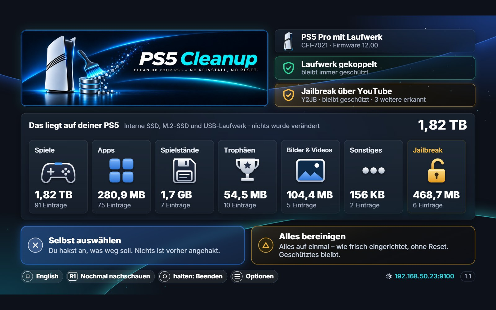
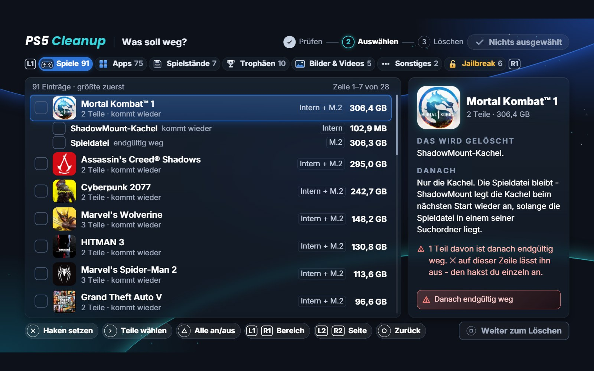
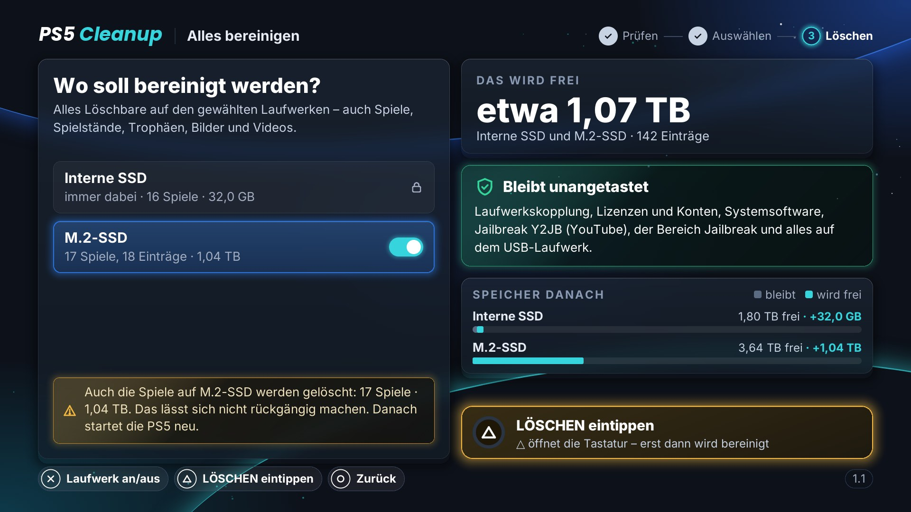
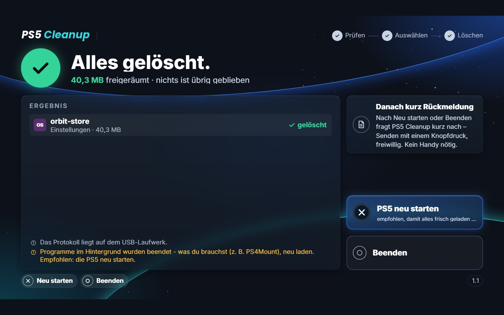
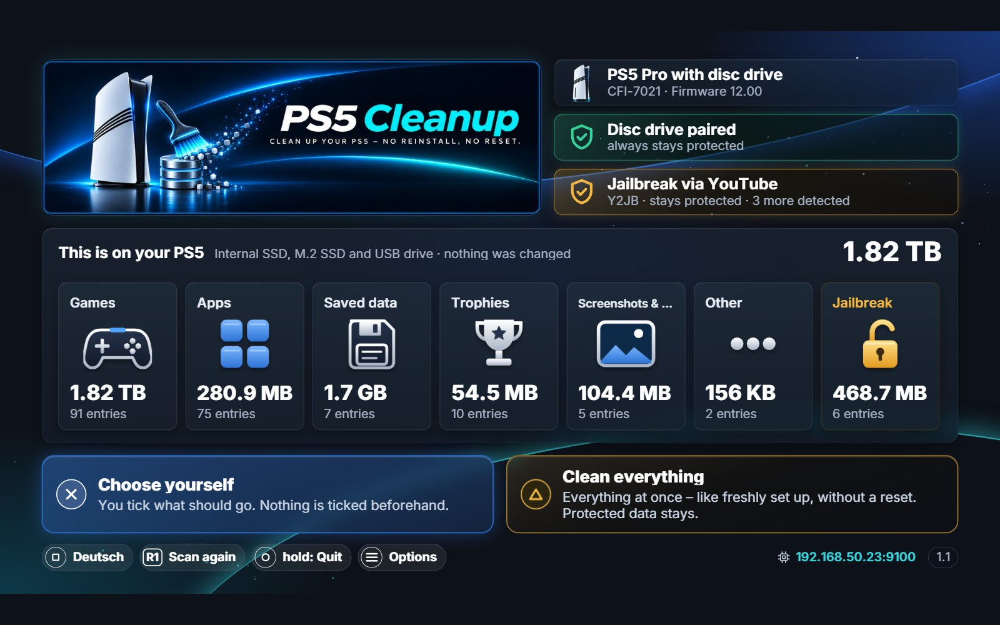
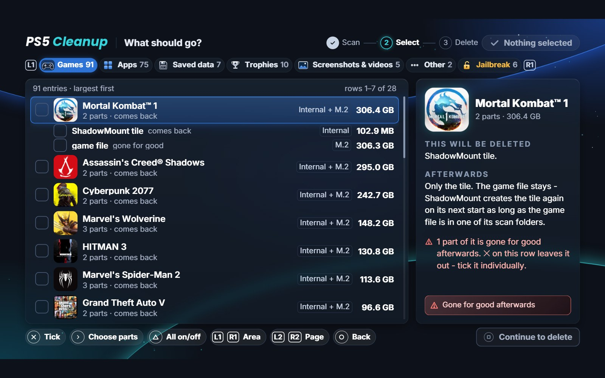
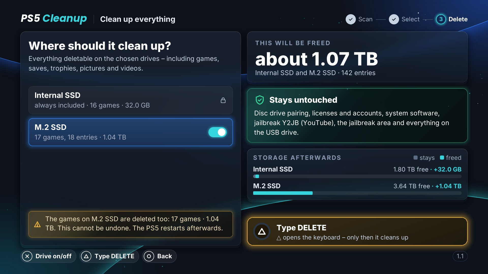
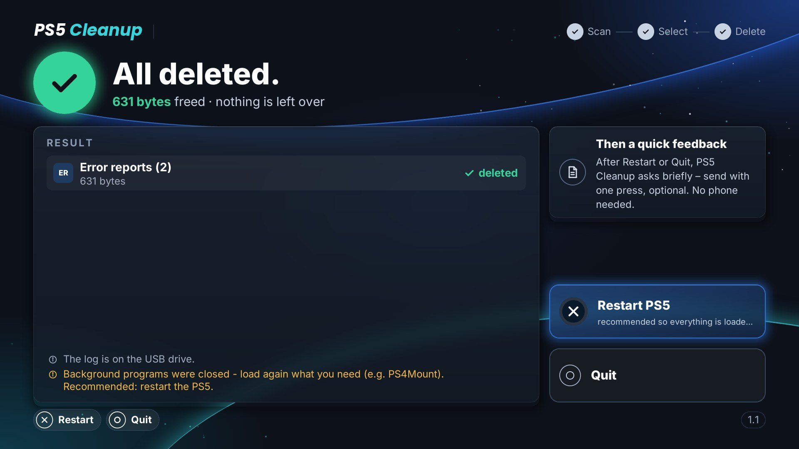

<b>🇩🇪 Deutsch</b> (zum Aufklappen)

 

**Deine PS5 aufräumen wie frisch eingerichtet – ohne Neuinstallation, ohne Zurücksetzen.**

   

### [⬇️ PS5 Cleanup 1.1 herunterladen](https://github.com/xXBneutzerNameXx/PS5-Cleanup/releases/latest)

Du brauchst nur eine Datei: <code>ps5cleanup_v1.1.elf</code>. Die ZIP enthält dieselbe Datei plus Anleitungen und Prüfsummen.

[Auf einen Blick](#auf-einen-blick) · [So geht's](#so-gehts) · [Rückmeldung](#rückmeldungen) · [Community](#community)

<b>Nach dem Nachschauen:</b> was auf deiner PS5 liegt, nach Bereichen – Spiele, Apps, Spielstände, Trophäen, Bilder &amp; Videos. Nichts wurde verändert.

<b>📸 Mehr Bilder</b> (Auswahl, Alles bereinigen, Fertig – zum Aufklappen)

 

<table>
<tr>
<td width="33%"></td>
<td width="33%"></td>
<td width="33%"></td>
</tr>
<tr>
<td><b>Auswahl:</b> jeder Eintrag mit Kachelbild, Speicherort und Größe. Rechts steht, was gelöscht wird und was danach passiert. Angehakt ist vorher nichts.</td>
<td><b>Alles bereinigen:</b> je Speicher, was frei wird – mit klarer Warnung, wenn auch die Spiele auf der M.2 gelöscht werden. Gelöscht wird erst, wenn du LÖSCHEN eintippst.</td>
<td><b>Fertig:</b> was gelöscht wurde, Protokoll auf dem USB-Laufwerk und Rückmeldung per QR-Code.</td>
</tr>
</table>

## Worum geht's?

Wer seine PS5 mit Jailbreak eine Weile nutzt, kennt das: tote Kacheln, Reste gelöschter Spiele, alte Downloads, Fehlerberichte, Daten von Tools, die man längst nicht mehr nutzt. Die Systemsoftware neu aufspielen will man deswegen aber nicht – erst recht nicht bei Slim und Pro, wo dabei die Laufwerks-Kopplung verloren gehen kann.

**PS5 Cleanup** läuft direkt auf der PS5, listet alles übersichtlich mit Namen auf und löscht nur das, was du auswählst.

**Zwei Wege:**
- **Selbst auswählen** – einzelne Einträge anhaken, z. B. wenn ein Spiel oder Tool Probleme macht: nur dessen Daten, Spielstand oder Trophäen löschen, der Rest bleibt.
- **Alles bereinigen** – alles auf der internen SSD auf einmal, wie frisch eingerichtet. M.2 und erweiterten Speicher schaltest du selbst dazu; vorher steht je Speicher, wie viele Spiele und Einträge gelöscht werden (Bestätigung mit `LÖSCHEN`).

Beim Start ist der **Testmodus** an: Du kannst alles anschauen, gelöscht wird nichts.

## Auf einen Blick

| 🧹 Sauber | 🛡️ Sicher | 🎮 Am Fernseher oder im Browser |
|---|---|---|
| Kacheln, Apps und Spiele trägt Sony selbst aus – keine leeren Kacheln, kein Datenbank-Neuaufbau | Jailbreak-Einstiege und PS4-Spiele sind geschützt. Gelöscht wird erst nach deiner Bestätigung | Eigene Kachel, Bedienung mit dem Controller – oder im Browser am Handy oder PC. Kein FTP, kein USB-Laufwerk nötig |
| **📦 Ein Block pro App** | **🧪 Testmodus** | **📱 Rückmeldung direkt aus der App** |
| Kachel oben, darunter alles, was dazugehört – zugeordnet nur mit Beleg, geraten wird nie | Die App startet im Testmodus: Sie zeigt alles wie beim echten Löschen und löscht nichts, bis du ihn ausschaltest | Mit Internet direkt von der PS5, sonst per QR-Code mit dem Handy – ohne Konto, ohne Passwörter |

<b>📋 Alle Funktionen im Einzelnen</b> (zum Aufklappen)

 

**🎮 Bedienung**

- **Eigene Kachel** auf dem Startbildschirm, Bedienung mit dem Controller am Fernseher – kein PC, kein Homebrew Launcher nötig
- **Bedienung im Browser** am Handy oder PC, im Heimnetz, ohne Anmeldung – dieselbe App, dieselben Bestätigungen
- **Übersicht auf einen Blick:** Modell, Firmware, eingerichtete Jailbreak-Einstiege, Laufwerks-Kopplung und freier Speicher
- **Größe jedes Eintrags direkt in der Liste** (wird im Hintergrund gezählt)
- **Protokoll** jederzeit in den Optionen („Protokoll speichern“); beim Löschen zusätzlich von selbst als Datei auf dem USB-Laufwerk, sonst auf der internen Platte oder der M.2
- **Deutsch und Englisch** – richtet sich nach der Systemsprache der PS5, Quadrat auf der Startseite schaltet um
- **Im Payload Manager als eigene Quelle:** Settings → Manage Sources → Add Source, dann `https://raw.githubusercontent.com/xXBneutzerNameXx/PS5-Cleanup/main/payloads.json` – neue Versionen kommen dort von selbst an (Idee und Vorlage: Strongt1me)

**🧹 Sauber löschen**

- **Ein Durchgang reicht** – gewählte Programme werden vorher beendet, für alle nach denselben Regeln; Programme, die nur fremde Ordner eingebunden haben, bleiben in Ruhe
- **Kacheln verschwinden sauber** über Sonys eigenen Deinstallations-Dienst, **Bilder und Videos** über Sonys Löschdienst, **Spielstände** samt Eintrag in Sonys Spielstand-Liste
- **M.2: jedes Spiel und jede Datei einzeln** – die Ordner selbst bleiben stehen, für M.2 und erweiterten Speicher gibt es eine eigene Rückfrage
- **ShadowMount-Spiele:** wahlweise nur die Kachel oder Spiel samt Kachel – ShadowMount+ wird vorher sauber angehalten
- **Playden:** einzelne Steam-Spiele lassen sich gezielt entfernen – Spieldateien, Kachel und Eintrag in Playdens Spieleliste in einem Durchgang, Playden selbst bleibt installiert. Spiele, die nur noch in Playdens Liste stehen, werden ausgetragen. Die Spielstände stehen mit Bild und Namen unter Spielstände, auch von Spielen, die schon weg sind. Playdens eigene Daten sind rot markiert. Playden muss dafür geschlossen sein
- **Am Ende:** Ergebnisseite mit jedem Eintrag – bleibt etwas übrig, steht der Grund direkt darunter; dann ✕ Neu starten (empfohlen) oder ○ Beenden

**🔎 Erkennen und zuordnen**

- **Ein Block pro App und Spiel:** Kachel oben, darunter alles, was dazugehört – zugeordnet nur mit Beleg (Kennung, Name oder das Programm der App selbst)
- **Klarnamen und Kachelbilder** in 7 Bereichen: Spiele (PS5, PS4 und PS3-ISO) mit **Update und DLCs einzeln wählbar**, Apps, Spielstände, Trophäen, Bilder & Videos, Sonstiges, Jailbreak
- **Unbekannte Homebrew-Apps:** ihre Ordner werden aus den Programmdateien erkannt – Vermutetes nie automatisch angehakt

**🛡️ Sicherheit**

- **Jailbreak-Schutz:** YouTube (Y2JB), Netflix ('N Hack), Lua-Spiele, PS2-Spielstand-Jailbreak und offline gespeicherter WebKit-Jailbreak werden erkannt, nie automatisch angehakt und vor dem Löschen deutlich gewarnt
- **Nachschauen und Anhaken löscht nichts** – gelöscht wird erst nach ausdrücklicher Bestätigung (Selbst auswählen: ✕ 2 Sekunden halten, Alles bereinigen: `LÖSCHEN` eintippen)
- **Testmodus** beim Start: alles anschauen, nichts löschen – in den Optionen ausschalten

## Voraussetzungen

- PS5 mit Jailbreak und einem Payload-Lader oder dem Payload Manager
- Kein PC, kein FTP und kein USB-Laufwerk nötig
- Für die Bedienung im Browser: Handy oder PC im selben Heimnetz wie die PS5

## So geht's

1. Jailbreak laden, `ps5cleanup_v1.1.elf` aus den [Releases](https://github.com/xXBneutzerNameXx/PS5-Cleanup/releases/latest) über den Payload-Lader oder den Payload Manager starten. Steckt ein USB-Laufwerk, kommt das Protokoll darauf. Wer lieber am Handy oder PC bedient, öffnet dort im Browser die Adresse unten auf der Startseite.
2. **Nachschauen** und anschauen, was gefunden wurde. Die App ist im **Testmodus** und löscht nichts. Stimmt die Liste, den Testmodus in den Optionen ausschalten.
3. ✕ = **Selbst auswählen**: Einträge anhaken, □ = Weiter zum Löschen, zum Bestätigen ✕ 2 Sekunden halten – oder △ = **Alles bereinigen**: Laufwerke wählen, `LÖSCHEN` eintippen.
4. Am Ende zeigt die Ergebnisseite jeden Eintrag, Übriggebliebenes mit Grund. Dann **✕ Neu starten** (empfohlen) oder **○ Beenden** – vorher kommt die freiwillige Rückmeldung. Nach dem Neustart den Jailbreak wie gewohnt starten.

> [!WARNING]
> **Kein „Datenbank neu aufbauen“:** Sonys „Datenbank neu aufbauen“ (abgesicherter Modus) löscht installierte **PS4-Spiele aus Fake-PKGs** – sie müssen danach neu installiert werden. Mit PS5 Cleanup ist der Neuaufbau nicht nötig. **Nie** „PS5 zurücksetzen“ oder „Systemsoftware neu installieren“ wählen.

Ausführliche Anleitung: [LIESMICH.txt](LIESMICH.txt)

<b>✨ Neu in 1.1 – neues Aussehen, Bedienung im Browser, Alles bereinigen mit Vorschau</b> (zum Aufklappen)

 

**Neues Aussehen**
- Komplett neue Oberfläche am Fernseher: Startseite mit Konsole, Laufwerks-Kopplung und Jailbreak auf einen Blick, nach dem Nachschauen eine Übersicht aller Bereiche mit Größen.
- Auswählen mit Reitern (Spiele, Apps, Spielstände, Trophäen, Bilder & Videos, Sonstiges, Jailbreak). Jeder Eintrag mit Kachelbild, Speicherort und Größe, rechts steht, was gelöscht wird und was danach passiert.
- Spiele und Programme stehen als Block mit ihren Teilen – aufklappen und einzelne Teile wählen. Der Kopf des Blocks nennt genau das, was der Haken mitnimmt.
- Neue Bestätigungsseite: links, was gelöscht wird, rechts, was auf jeden Fall bleibt und wie viel Platz danach frei ist.
- Beim Löschen eine Liste mit Kachelbildern. Nachschauen und Löschen zeigen den echten Fortschritt („Eintrag x von y“), beim Nachschauen mit geschätzter Restzeit.
- Sprache und „Nochmal nachschauen“ direkt auf der Startseite, deutlichere Tastenleiste.

**Bedienung im Browser**
- PS5 Cleanup lässt sich vom Handy oder PC aus bedienen – die Browser-Seite zeigt dasselbe wie der Fernseher. Die Adresse steht unten auf der Startseite.

**Alles bereinigen mit Vorschau**
- Vorher steht je Speicher (interne SSD, M.2, erweiterter Speicher), wie viele Spiele und Einträge gelöscht werden, wie viel frei wird und wie viel Platz danach frei ist.
- Deutliche Warnung, wenn auch die Spiele auf der M.2 oder dem erweiterten Speicher gelöscht werden – die Spieldateien von ShadowMount-Spielen sind mitgezählt.
- Zur Bestätigung LÖSCHEN eintippen. Direkt vor dem Löschen vergleicht PS5 Cleanup noch einmal mit der wirklichen Auswahl – ist es mehr als angezeigt, fragt es neu.

**Gründlicher und sicherer löschen**
- Gewählte Programme werden vor dem Löschen beendet – für alle nach denselben Regeln. Programme, die nur fremde Ordner eingebunden haben, bleiben in Ruhe.
- Kacheln und Spiel-Updates entfernt Sonys eigene Deinstallation; PS5 Cleanup wartet auf Sonys Antwort, statt vorzeitig weiterzumachen.
- Startordner fremder Apps unter `/system_ex/app` werden erkannt. Vor dem Löschen fragt PS5 Cleanup bei Sony nach, ob sie wirklich übrig sind.
- Liegt eine Spieldatei hinter einer Verknüpfung, wird nur die Kachel angeboten – nie die fremde Datei.
- Klappt etwas nur zum Teil, steht es als „teilweise“ im Ergebnis, nie als erledigt.
- Bleibt etwas übrig, steht der Grund direkt auf der Ergebnisseite unter dem Eintrag – nicht mehr nur im Protokoll.

**Mehr erkannt, mehr Bilder**
- Programme ohne Kachel bekommen ihr Bild aus der Programmdatei (auch aus großen ELF-Dateien) oder aus dem Katalog des Payload-Verwalters.
- Download- und Daten-Ordner stehen bei dem Programm, zu dem sie gehören (z. B. PS5Save, ps-patch-system).
- Playden: einzelne Spiele werden komplett entfernt – Spieldateien, Kachel und Eintrag in Playdens Liste, Playden selbst bleibt. Reste schon gelöschter Spiele in Playdens Liste werden ausgetragen. Spielstände mit Bild und Namen aus Playdens Bibliothek, im Bereich Spielstände.

**Updates und Rückmeldung**
- Die App schaut beim Start, ob es eine neue Version gibt, und holt sie auf Wunsch – über eine eigene, geprüfte HTTPS-Verbindung.
- Rückmeldung direkt aus der App senden. Ohne Internet geht es per QR-Code mit dem Handy.

**Unter der Haube**
- Alte Sonderwege aus der Zeit von 1.0.5 und 1.0.6 entfernt, ein gemeinsames Regelwerk für alle Löschwege. Jede Änderung wurde einzeln geprüft und mit dem automatischen Gesamttest abgesichert.

Getestet auf einer PS5 Pro (CFI-7021) mit Firmware 12.00, M.2 und USB-Laufwerk – „Selbst auswählen“ und „Alles bereinigen“, am Fernseher und im Browser. Andere Modelle und Firmwares sind nicht gesperrt, aber noch nicht getestet – dort bitte im Testmodus zuerst schauen, ob die Liste stimmt. [Alle Neuerungen](https://github.com/xXBneutzerNameXx/PS5-Cleanup/releases)

## Was das Programm nicht anfasst

Systemsoftware, Laufwerks-Kopplung, Benutzerkonto, Aktivierung, echte Lizenzen und die Sony-Systemanwendungen. Es wird nichts installiert und nichts zurückgesetzt. Sonys Datenbanken ändert die PS5-App nur gezielt: die Einträge gelöschter Spielstände, kaputte Zusatzinhalt-Angaben eines Spiels, das du löschst, und Kacheln, die ein Tool direkt in Sonys App-Liste eingetragen hat (z. B. TabShifter) und die du zum Löschen auswählst. Jede dieser Änderungen wird vorher geprüft und ganz oder gar nicht gemacht.

## Datenschutz

PS5 Cleanup legt auf der PS5 nichts ab außer seiner eigenen Kachel und seinen **Protokollen** (USB-Laufwerk, sonst auf der PS5) – keine Einstellungen, keine Listen, kein Merken zwischen zwei Starts.

<b>Was dabei ins Netz geht</b> (zum Aufklappen)

 

- **Update-Hinweis:** Beim Start fragt PS5 Cleanup einmal bei GitHub (`api.github.com`) nach der neuesten Version. Gesendet wird nur diese Anfrage – wie beim Öffnen einer Webseite sieht GitHub dabei die Internet-Adresse. Ohne Internet passiert nichts.
- **Update holen:** nur wenn du es in den Optionen auswählst. Dann lädt PS5 Cleanup die neue Version von GitHub und prüft Größe, Prüfsumme und dass es wirklich PS5 Cleanup ist, bevor sie abgelegt wird. Ausgeführt wird sie nicht von selbst; geht etwas schief, bleibt die alte Version unverändert.
- **Bedienung im Browser:** Die Seite kommt von der PS5 selbst und antwortet nur Geräten aus dem Heimnetz. Ins Internet geht dabei nichts, im Browser bleibt nichts außer den Kachelbildern im Zwischenspeicher (höchstens 10 Minuten). Sobald PS5 Cleanup beendet ist, ist auch die Seite weg.
- **Rückmeldung:** siehe [Rückmeldungen](#rückmeldungen) – ohne dein „Senden“ geht nichts raus.

## Rückmeldungen

**Direkt aus der App:** Am Ende (vor „Neu starten“ oder „Beenden“) und in den Optionen unter „Rückmeldung geben“ fragt PS5 Cleanup kurz, ob alles geklappt hat – freiwillig, „Ohne Rückmeldung“ geht immer. Mit Internet sendet die PS5 direkt, ohne Internet zeigt sie einen QR-Code fürs Handy – ohne Konto, ohne PC.

<b>Was in der Rückmeldung steht</b> (zum Aufklappen)

 

Gesendet werden Version, Fassung, Bau-Stempel, Modellnummer, Firmware, Laufwerks-Kopplung, eingerichtete Jailbreak-Einstiege, angeschlossene Speicher, ShadowMount, Zahlen je Bereich, bei Fehlern kurze Fehlercodes (Schritt, Art des Eintrags, Ort, Code), deine Antwort und – wenn du willst – ein kurzer Text. **Nie dabei: Konten, Passwörter, IP- und MAC-Adressen, Seriennummer.** Das Wichtigste steht auf der Seite rechts unter „Das wird gesendet“; gesendet wird erst mit „Senden“.

**Mit Internet** schickt die PS5 zusätzlich das **bereinigte Protokoll** mit (IP-, E-Mail- und MAC-Adressen, Seriennummern und Benutzer-Kennung entfernt). Es enthält Namen von Spielen und Apps und Ordnerpfade deiner Konsole – damit sich ein Fehler nachvollziehen lässt. **Ohne Internet** stehen im QR-Code nur die Angaben und Zahlen, kein Protokoll; gespeichert wird erst, wenn du am Handy auf „Senden“ tippst. Wie bei jedem Webseitenaufruf sieht der Server kurz die Internet-Adresse – sie wird nicht gespeichert. Die Seite läuft bei Cloudflare unter `feedback.ps5cleanup.workers.dev` ([Datenschutz-Hinweis](https://feedback.ps5cleanup.workers.dev/datenschutz)).

Ausführlicher: Über [Issues](https://github.com/xXBneutzerNameXx/PS5-Cleanup/issues), die [Discussions](https://github.com/xXBneutzerNameXx/PS5-Cleanup/discussions) (Modell, Firmware und Ergebnis gern unter [Compatibility](https://github.com/xXBneutzerNameXx/PS5-Cleanup/discussions/categories/compatibility)) oder auf psxtools.de – am besten mit dem **Protokoll**. Das geht auch ohne etwas zu löschen: In den Optionen speichert „Protokoll speichern“ es auf das USB-Laufwerk – auch im Testmodus.

### 🗳️ PS5 Cleanup Community – Deine Meinung zählt!

**Welche PS5 nutzt du?** Hilf uns, PS5 Cleanup für verschiedene Konsolen und Firmware-Versionen zu verbessern!

[**🗳️ Jetzt abstimmen**](https://github.com/xXBneutzerNameXx/PS5-Cleanup/discussions/4) · [**💬 Diskussionen & Vorschläge**](https://github.com/xXBneutzerNameXx/PS5-Cleanup/discussions) · [**🎮 Kompatibilität melden**](https://github.com/xXBneutzerNameXx/PS5-Cleanup/discussions/categories/compatibility)

## Aufbau

Ordner im Quellcode (zum Aufklappen)

 

| Ordner | Inhalt |
|---|---|
| `1.1/kern/` | Kern der PS5-App: Schutzliste, Suche, Löschen, Abläufe |
| `1.1/app/` | Oberfläche am Fernseher (SDL2, DualSense), Bedienung im Browser (`fern.c`, `fern_seite.html`) und PS5-Anbindung (Sony-Deinstallation, Löschdienst, Spielstand-Liste) |
| `1.1/start/` | `ps5cleanup.elf`: Start, eigene Kachel (PSCL00001), Hintergrundteil für Selbstentfernung und Neustart |
| `1.1/db/` | Prüfung von Sonys Datenbanken (SQLite) |
| `1.1/rueckmeldung/` | Handy-Seite für die Rückmeldung per QR-Code (Cloudflare Worker) |
| `1.1/test/` | Tests am PC |
| `1.1/fremd/` | Anleitung und Skript für die fremden Bibliotheken (PCRE2, cJSON) |
| `Quellcode/` | die bisherige Windows-Fassung 1.0.6 (C#) und ältere Fassungen – nicht mehr weiterentwickelt |

## Lizenz

Die PS5-App (`1.1/`, `ps5cleanup_v1.1.elf`) steht unter der GPL-3.0 (oder später) – Copyright (c) 2026 da_Chris86. Der Code der bisherigen Windows-Fassung steht unter MIT. Details und Bestandteile anderer Urheber in [LICENSE.txt](LICENSE.txt).

## Danke an

[drakmor](https://github.com/drakmor) (ftpsrv, ps5-hwinfo), [earthonion](https://github.com/earthonion) (ddd_status), John Törnblom (ps5-payload-sdk, ftpsrv), [seregonwar](https://github.com/seregonwar) (zftpd), die Macher von ShadowMountPlus und PS5Upload, [Project Nayuki](https://www.nayuki.io/page/qr-code-generator-library) (QR-Code-Bibliothek) sowie Markus Scholtes (PS2EXE).

Entwickelt von da_Chris86 mit Claude (Anthropic). Unabhängige Code-Prüfung: OpenAI Codex. Idee, Vorgaben und die Tests an der echten Konsole kommen von mir.

**Benutzung auf eigene Gefahr – Gelöschtes ist endgültig weg.**
Inoffizielles Community-Projekt, keine Verbindung zu Sony. PlayStation und PS5 sind Marken von Sony Interactive Entertainment Inc.

**Clean up your PS5 like freshly set up – no reinstall, no reset.**

   

### [⬇️ Download PS5 Cleanup 1.1](https://github.com/xXBneutzerNameXx/PS5-Cleanup/releases/latest)

You only need one file: <code>ps5cleanup_v1.1.elf</code>. The ZIP contains the same file plus guides and checksums.

[At a glance](#at-a-glance) · [How to use](#how-to-use) · [Feedback](#feedback) · [Community](#community-en)

<b>After scanning:</b> what is on your PS5, by area – games, apps, saved data, trophies, screenshots &amp; videos. Nothing was changed.

<b>📸 More screenshots</b> (select, clean up everything, done – click to expand)

 

<table>
<tr>
<td width="33%"></td>
<td width="33%"></td>
<td width="33%"></td>
</tr>
<tr>
<td><b>Select:</b> every entry with its tile picture, drive and size. On the right: what will be deleted and what happens afterwards. Nothing is ticked beforehand.</td>
<td><b>Clean up everything:</b> what is freed per drive – with a clear warning when the games on the M.2 are deleted too. Nothing is deleted until you type DELETE.</td>
<td><b>Done:</b> what was deleted, the log on the USB drive and feedback via QR code.</td>
</tr>
</table>

The app runs in German and English – switch the language on the start screen.

## What is it?

**PS5 Cleanup** brings a jailbroken PS5 back to a freshly-set-up state – without reinstalling or resetting the system software. It runs **directly on the PS5** (`ps5cleanup_v1.1.elf`, own home-screen tile, no PC and no Homebrew Launcher needed, DualSense on your TV – or in a browser on your phone or PC), lists everything with readable names and deletes only what you select – single games, saved data, trophies (e.g. when one game or tool causes problems) or everything at once. Available in **English and German** (follows the PS5 system language; Square on the start screen switches it).

## At a glance

| 🧹 Clean | 🛡️ Safe | 🎮 On your TV or in a browser |
|---|---|---|
| Tiles, apps and games are removed by Sony itself – no empty tiles, no database rebuild | Jailbreak entry points and PS4 games are protected. Nothing is deleted until you confirm | Own home-screen tile, controlled with the controller – or in a browser on your phone or PC. No FTP, no USB drive needed |
| **📦 One block per app** | **🧪 Test mode** | **📱 Feedback right from the app** |
| The tile at the top, everything that belongs to it below – assigned only with evidence, nothing is ever guessed | The app starts in test mode: it shows everything like real deleting and deletes nothing until you switch it off | Sent directly by the PS5 with internet, otherwise via QR code on your phone – no account, no passwords |

<b>📋 All features in detail</b> (click to expand)

 

**🎮 Controls**

- Control with the DualSense on your TV or in a browser on your phone or PC (home network, no login)
- Dashboard for model, firmware, jailbreak entry points, disc drive pairing and free storage
- Size of every entry shown in the list
- Log any time in the Options ("Save log"), also saved as a file by itself when deleting
- As its own source in the Payload Manager: Settings → Manage Sources → Add Source, then `https://raw.githubusercontent.com/xXBneutzerNameXx/PS5-Cleanup/main/payloads.json` – new versions arrive there by themselves (idea and template: Strongt1me)

**🧹 Clean deleting**

- One pass is enough – selected programs are closed first, for all by the same rules; programs that only mounted other folders are left alone
- Tiles removed via Sony's uninstall service, screenshots and videos via Sony's delete service, saved data together with its entry in the saved data list
- Every game and file on the M.2 listed individually (folders are kept)
- ShadowMount games: tile only or game + tile, ShadowMount+ is stopped cleanly first
- Playden: single Steam games can be removed on their own – game files, tile and entry in Playden's game list in one pass, Playden itself stays installed. Games that are only left in Playden's list are removed from it. Their saved data is shown with picture and name under saved data, also for games that are already gone. Playden's own data is marked red. Playden has to be closed for this
- At the end: result screen with every entry – if anything is left over, the reason is shown right below it; then restart (recommended) or quit

**🔎 Recognising and assigning**

- One block per app and game (tile at the top, everything belonging to it below, assigned only with evidence – ID, name or the app's own program)
- Readable names and tile images in 7 areas, games (PS5, PS4 and PS3 ISO) with update and each DLC selectable separately
- Unknown homebrew apps: their folders are found from their program files – anything only assumed is never ticked automatically

**🛡️ Safety**

- Jailbreak detection and protection (YouTube/Y2JB, Netflix 'N Hack, Lua games, PS2 save jailbreak, offline WebKit jailbreak)
- Scanning and ticking deletes nothing – nothing is deleted until you confirm (Choose yourself: hold ✕ for 2 seconds, Clean up everything: type `DELETE`)
- Test mode at start: look at everything, delete nothing – switch it off in the Options

## Requirements

- Jailbroken PS5 with a payload loader or the Payload Manager
- No PC, no FTP and no USB drive needed
- For browser control: a phone or PC in the same home network as the PS5

## How to use

1. Load your jailbreak, start `ps5cleanup_v1.1.elf` from the [releases](https://github.com/xXBneutzerNameXx/PS5-Cleanup/releases/latest) with your payload loader or Payload Manager. To use your phone or PC instead, open the address shown at the bottom of the start screen in a browser.
2. *Scan* and look at what was found. The app is in **test mode** and deletes nothing. If the list is right, switch test mode off in the Options.
3. ✕ = *Choose yourself*: tick entries, □ = Continue to delete, hold ✕ for 2 seconds to confirm – or △ = *Clean up everything*: choose the drives, type `DELETE`.
4. At the end the result screen shows every entry, anything left over with the reason. Then ✕ *Restart* (recommended) or ○ *Quit* – the optional feedback comes first. Then start your jailbreak as usual.

> [!WARNING]
> **No "Rebuild Database":** Sony's "Rebuild Database" (Safe Mode) deletes installed **PS4 games from fake PKGs** – they have to be installed again afterwards. With PS5 Cleanup the rebuild is not needed. **Never** choose "Reset PS5" or "Reinstall System Software".

Full guide: [README_EN.txt](README_EN.txt)

<b>✨ New in 1.1 – new look, browser control, clean up everything with preview</b> (click to expand)

 

**New look**
- A completely new interface on the TV: start screen with console, drive pairing and jailbreak at a glance, and after scanning an overview of all areas with their sizes.
- Selecting with tabs (games, apps, saved data, trophies, screenshots & videos, other, jailbreak). Every entry with its tile picture, drive and size; on the right, what will be deleted and what happens afterwards.
- Games and programs are shown as a block with their parts – expand it and pick single parts. The block header names exactly what its checkbox takes along.
- New confirm page: on the left what will be deleted, on the right what always stays and how much space is free afterwards.
- While deleting, a list with tile pictures. Scanning and deleting show the real progress ("entry x of y"), scanning with an estimate of the time left.
- Language and "Scan again" right on the start screen, a clearer button bar.

**Browser control**
- PS5 Cleanup can be operated from your phone or PC – the browser page shows the same as the TV. The address is at the bottom of the start screen.

**Clean up everything with preview**
- Before you confirm, it shows per drive (internal SSD, M.2, extended storage) how many games and entries are deleted, how much is freed and how much space is free afterwards.
- A clear warning when the games on the M.2 or extended storage are deleted too – game files of ShadowMount games are included.
- Type DELETE to confirm. Right before deleting, PS5 Cleanup checks the real selection once more – if it is more than shown, it asks again.

**More thorough and safer deleting**
- Selected programs are closed before deleting – all by the same rules. Programs that only mounted other folders are left alone.
- Tiles and game updates are removed through Sony's own uninstaller; PS5 Cleanup waits for Sony's answer instead of moving on too early.
- Start folders of other apps under `/system_ex/app` are recognised. Before deleting, PS5 Cleanup asks Sony whether they are really left over.
- If a game file sits behind a link, only the tile is offered – never the other file.
- If something only partly works, the result says "partly" – never done.
- If something is left over, the reason is shown right under the entry on the result page – not only in the log.

**More recognised, more pictures**
- Programs without a tile get their picture from their program file (also from large ELF files) or from the payload manager's catalog.
- Download and data folders are listed with the program they belong to (e.g. PS5Save, ps-patch-system).
- Playden: single games are removed completely – game files, tile and entry in Playden's list, Playden itself stays. Leftovers of already deleted games are removed from Playden's list. Saved data with picture and name from Playden's library, in the saved data area.

**Updates and feedback**
- The app checks for a new version at start and fetches it if you want – over its own verified HTTPS connection.
- Send feedback directly from the app. Without internet, it works via QR code with your phone.

**Under the hood**
- Old special paths from the 1.0.5 and 1.0.6 days removed, one shared set of rules for all ways of deleting. Every change was checked on its own and secured with the automatic full test.

Tested on a PS5 Pro (CFI-7021), firmware 12.00, with M.2 and USB drive – "Choose yourself" and "Clean up everything", on the TV and in the browser. Other models and firmwares are not blocked but untested – there, please check in test mode first that the list is right. [All changes](https://github.com/xXBneutzerNameXx/PS5-Cleanup/releases)

## Not touched by the program

System software, disc drive pairing, user account, activation and real licenses, Sony system apps. Nothing is installed or reset. The PS5 app changes Sony's databases only selectively: the entries of deleted saved data, broken add-on information of a game you delete, and tiles that a tool entered directly into Sony's app list (e.g. TabShifter) and that you select for deletion. Each of these changes is checked first and made completely or not at all.

## Privacy

PS5 Cleanup keeps nothing on the PS5 except its own tile and its **logs** (USB drive, otherwise on the PS5) – no settings, no lists, nothing remembered between two starts.

<b>What goes over the network</b> (click to expand)

 

- **Update notice:** at start, PS5 Cleanup asks GitHub (`api.github.com`) once for the latest version. Only this request is sent – as when opening any website, GitHub sees the internet address. Without internet nothing happens.
- **Get update:** only if you choose it in the Options. Then PS5 Cleanup downloads the new version from GitHub and checks size, checksum and that it really is PS5 Cleanup before saving it. It is not run automatically; if anything goes wrong, the old version stays unchanged.
- **Browser control:** the page comes from the PS5 itself and only answers devices in the home network. Nothing goes to the internet; nothing stays in the browser except the tile images in its cache (10 minutes at most). Once PS5 Cleanup has quit, the page is gone too.
- **Feedback:** see [Feedback](#feedback) – nothing goes out without your "Send".

## Feedback

**Right from the app:** at the end (before "Restart" or "Quit") and in the Options under "Give feedback", PS5 Cleanup briefly asks whether everything worked – optional, "Without feedback" always works. With internet the PS5 sends it directly, without internet it shows a QR code for your phone – no account, no PC.

<b>What the feedback contains</b> (click to expand)

 

It contains version, edition, build stamp, model number, firmware, drive pairing, jailbreak entry points, connected storage, ShadowMount, numbers per area, for errors short error codes (step, kind of entry, location, code), your answer and – if you like – a short note. **Never included: accounts, passwords, IP and MAC addresses, serial number.** The key details are shown on the right of the screen under "This will be sent"; nothing goes out until you choose "Send".

**With internet** the PS5 also sends the **cleaned log** (IP, e-mail and MAC addresses, serial numbers and the user ID removed). It contains names of games and apps and folder paths of your console – so that an error can be traced. **Without internet** the QR code only holds the details and numbers, no log; nothing is stored until you tap "Send" on your phone. As with any website visit, the server briefly sees the internet address – it is not stored. The page runs on Cloudflare at `feedback.ps5cleanup.workers.dev` ([privacy notice](https://feedback.ps5cleanup.workers.dev/datenschutz?l=en)).

More detail: via [issues](https://github.com/xXBneutzerNameXx/PS5-Cleanup/issues), [Discussions](https://github.com/xXBneutzerNameXx/PS5-Cleanup/discussions) (model, firmware and result under [Compatibility](https://github.com/xXBneutzerNameXx/PS5-Cleanup/discussions/categories/compatibility)) or on psxtools.de – ideally with the **log**. This also works without deleting anything: in the Options, "Save log" saves it to the USB drive – in test mode too.

### 🗳️ PS5 Cleanup Community – Your Feedback Matters!

**Which PS5 do you own?** Help us improve PS5 Cleanup across different console models and firmware versions!

[**🗳️ Vote in our poll**](https://github.com/xXBneutzerNameXx/PS5-Cleanup/discussions/4) · [**💬 Join discussions**](https://github.com/xXBneutzerNameXx/PS5-Cleanup/discussions) · [**🎮 Report compatibility**](https://github.com/xXBneutzerNameXx/PS5-Cleanup/discussions/categories/compatibility)

## License and thanks

The PS5 app (`1.1/`, `ps5cleanup_v1.1.elf`) is GPL-3.0-or-later (c) 2026 da_Chris86; the code of the former Windows version is MIT – details and third-party components in [LICENSE.txt](LICENSE.txt).

Thanks to [drakmor](https://github.com/drakmor) (ftpsrv, ps5-hwinfo), [earthonion](https://github.com/earthonion) (ddd_status), John Törnblom (ps5-payload-sdk, ftpsrv), [seregonwar](https://github.com/seregonwar) (zftpd), the makers of ShadowMountPlus and PS5Upload, [Project Nayuki](https://www.nayuki.io/page/qr-code-generator-library) (QR code library) and Markus Scholtes (PS2EXE).

Developed by da_Chris86 with Claude (Anthropic). Independent code review: OpenAI Codex. Idea, requirements and real-console testing by da_Chris86.

**Use at your own risk – deleted data is gone for good.** Unofficial community project, not affiliated with Sony. PlayStation and PS5 are trademarks of Sony Interactive Entertainment Inc.
