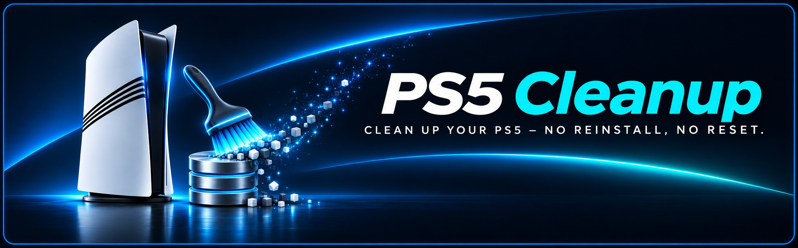
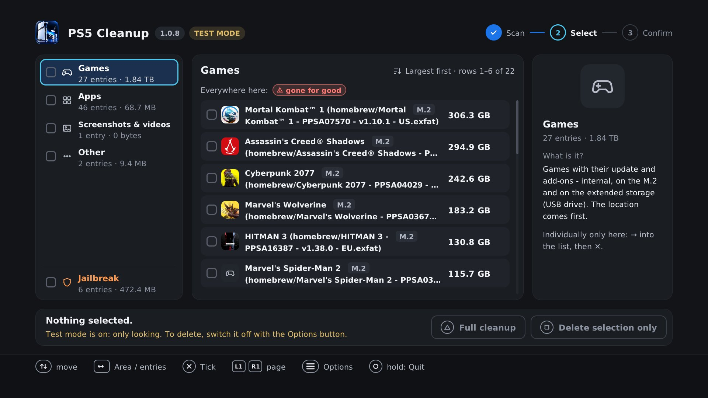
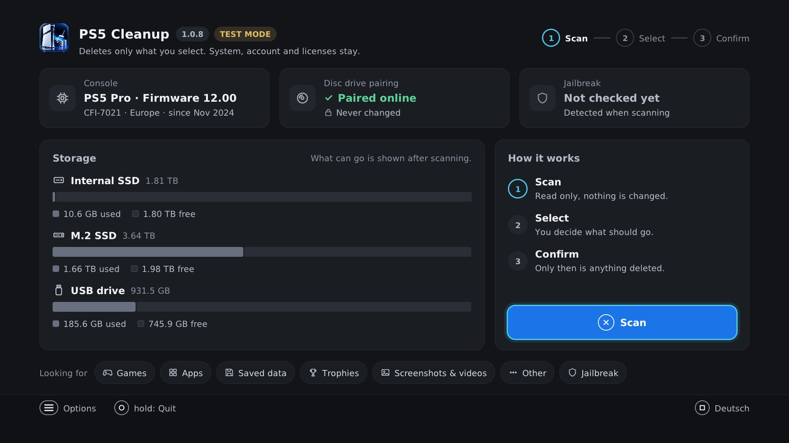
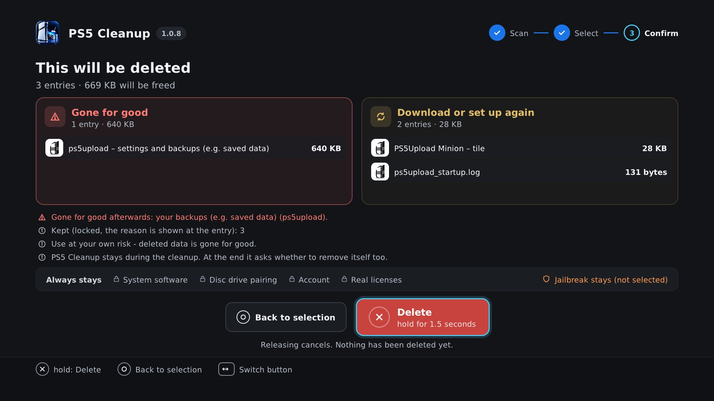
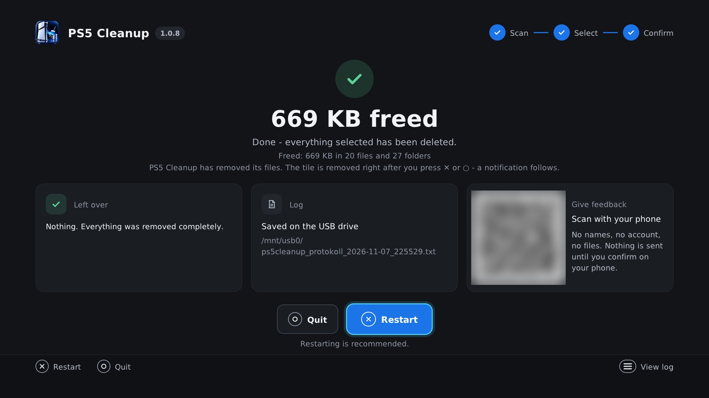
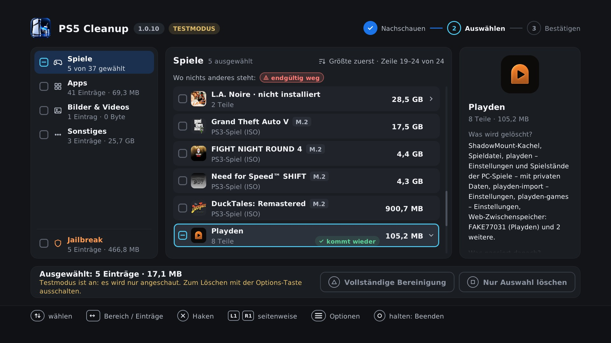

**Clean up your jailbroken PS5 like freshly set up – no reinstall, no reset.**

   

### [Download PS5 Cleanup 1.0.10](https://github.com/xXBneutzerNameXx/PS5-Cleanup/releases/latest)

You only need one file: `ps5cleanup_v1.0.10.elf`

More screenshots

 

<table>
<tr>
<td width="33%"></td>
<td width="33%"></td>
<td width="33%"></td>
</tr>
<tr>
<td>Start: console, firmware, jailbreak, drive pairing and storage at a glance. Scanning changes nothing.</td>
<td>Confirm: before anything happens, it lists exactly what will be deleted and what always stays.</td>
<td>Done: space freed, log on the USB drive and a QR code for feedback.</td>
</tr>
</table>

## What it does

After a while with a jailbroken PS5 you collect dead tiles, leftovers of deleted games, old downloads, crash reports and data of tools you no longer use. Reinstalling the system software is not an option – on Slim and Pro you can lose the disc drive pairing.

PS5 Cleanup runs directly on the PS5, lists everything with readable names and deletes only what you select. You can remove single games, saved data or trophies, or clean up everything at once. It runs on your TV with the DualSense or in a browser on your phone or PC, in English or German.

- Tiles, apps and games are removed by Sony's own uninstall service – no empty tiles, no database rebuild.
- Everything that belongs to an app is listed in one block below its tile.
- Jailbreak entry points and PS4 games are protected.
- The app starts in test mode: you can look at everything, nothing is deleted.

## How to use

1. Load your jailbreak and start `ps5cleanup_v1.0.10.elf` with your payload loader or the Payload Manager. To use your phone or PC instead, open the address shown at the bottom of the start screen.
2. Scan and check what was found. If the list is right, switch test mode off in the Options menu.
3. Tick entries and press Square to delete them (hold ✕ to confirm), or Triangle for a full cleanup (type `DELETE`).
4. At the end, restart the PS5 (recommended) and load your jailbreak as usual.

> [!WARNING]
> **No “Rebuild Database”:** Sony's rebuild in Safe Mode deletes installed PS4 games from fake PKGs. With PS5 Cleanup it isn't needed. Never choose “Reset PS5” or “Reinstall System Software”.

Full guide: [README_EN.txt](README_EN.txt) · Payload Manager source: `https://raw.githubusercontent.com/xXBneutzerNameXx/PS5-Cleanup/main/payloads.json`

All features

 

Controls
- DualSense on your TV, or a browser on your phone or PC in your home network (no login)
- Overview of model, firmware, jailbreak entry points, drive pairing and free storage
- Size of every entry in the list, log any time with Options

Deleting
- One pass is enough. Background programs are closed first; FTP server, nanoDNS, Payload Manager and the jailbreak keep running.
- Tiles via Sony's uninstall service, screenshots and videos via Sony's delete service, saved data together with its entry in the saved data list
- ShadowMount games: tile only, or game and tile
- Playden (Steam games): removed together with their entry in Playden's game list

Recognising
- Readable names and tile images in 7 areas; games (PS5, PS4, PS3 ISO) with update and each DLC selectable separately
- Unknown homebrew apps: their folders are found from their program files. Anything only assumed is never ticked automatically.

Safety
- Jailbreak entry points are detected and protected (YouTube/Y2JB, Netflix 'N Hack, Lua games, PS2 save jailbreak, offline WebKit jailbreak)
- Nothing is deleted until you confirm

## What stays untouched

System software, disc drive pairing, user account, activation and real licenses, Sony system apps. Nothing is installed or reset. Sony's databases are only changed where needed for a clean removal (entries of deleted saved data, tiles a tool wrote directly into Sony's app list), and each change is checked first and done completely or not at all.

Privacy

 

PS5 Cleanup keeps nothing on the PS5 except its own tile and its logs.

- Update check: at start it asks GitHub once for the latest version number. Nothing is downloaded or run.
- Browser control: the page comes from the PS5 itself and only answers devices in your home network.
- Feedback: the PS5 sends nothing. You scan a QR code with your phone and decide yourself.

## Feedback

At the end, and under Options → Log & feedback, PS5 Cleanup shows a QR code. Scan it with your phone and tap “It worked” or “Problem” – no account needed. The link contains model, firmware and short error codes, but no game names, no account and no IP of the PS5. ([Privacy notice](https://feedback.ps5cleanup.workers.dev/datenschutz?l=en))

More detail is welcome via [issues](https://github.com/xXBneutzerNameXx/PS5-Cleanup/issues) or [discussions](https://github.com/xXBneutzerNameXx/PS5-Cleanup/discussions), ideally with the log. Which PS5 do you use? [Tell us in the poll](https://github.com/xXBneutzerNameXx/PS5-Cleanup/discussions/4).

## License and thanks

The PS5 app is GPL-3.0-or-later (c) 2026 da_Chris86; the code of the former Windows version is MIT. Details and third-party components: [LICENSE.txt](LICENSE.txt).

Thanks to [drakmor](https://github.com/drakmor) (ftpsrv, ps5-hwinfo), [earthonion](https://github.com/earthonion) (ddd_status), John Törnblom (ps5-payload-sdk, ftpsrv), [seregonwar](https://github.com/seregonwar) (zftpd), the makers of ShadowMountPlus and PS5Upload, [Project Nayuki](https://www.nayuki.io/page/qr-code-generator-library) (QR code library) and Markus Scholtes (PS2EXE). Payload Manager source: idea and template by Strongt1me.

Developed by da_Chris86 with Claude (Anthropic), independent code review by OpenAI Codex. Idea, requirements and testing on a real console by da_Chris86.

Use at your own risk – deleted data is gone for good. Unofficial community project, not affiliated with Sony. PlayStation and PS5 are trademarks of Sony Interactive Entertainment Inc.

---

<b>Deutsch</b>

 

**Deine PS5 mit Jailbreak aufräumen wie frisch eingerichtet – ohne Neuinstallation, ohne Zurücksetzen.**

[PS5 Cleanup 1.0.10 herunterladen](https://github.com/xXBneutzerNameXx/PS5-Cleanup/releases/latest) – du brauchst nur `ps5cleanup_v1.0.10.elf`.

### Worum geht's?

Wer seine PS5 mit Jailbreak eine Weile nutzt, sammelt tote Kacheln, Reste gelöschter Spiele, alte Downloads, Fehlerberichte und Daten von Tools, die man längst nicht mehr nutzt. Die Systemsoftware neu aufspielen will man deswegen nicht – bei Slim und Pro kann dabei die Laufwerks-Kopplung verloren gehen.

PS5 Cleanup läuft direkt auf der PS5, listet alles mit Namen auf und löscht nur, was du auswählst: einzelne Spiele, Spielstände oder Trophäen, oder alles auf einmal. Bedienung am Fernseher mit dem Controller oder im Browser am Handy oder PC, auf Deutsch oder Englisch.

- Kacheln, Apps und Spiele trägt Sony selbst aus – keine leeren Kacheln, kein Datenbank-Neuaufbau.
- Alles, was zu einer App gehört, steht in einem Block unter ihrer Kachel.
- Jailbreak-Einstiege und PS4-Spiele sind geschützt.
- Die App startet im Testmodus: alles anschauen, nichts wird gelöscht.

### So geht's

1. Jailbreak laden und `ps5cleanup_v1.0.10.elf` über den Payload-Lader oder den Payload Manager starten. Wer lieber am Handy oder PC bedient, öffnet die Adresse unten auf der Startseite.
2. Nachschauen und prüfen, was gefunden wurde. Stimmt die Liste, den Testmodus im Options-Menü ausschalten.
3. Einträge anhaken und mit Quadrat löschen (✕ gedrückt halten zum Bestätigen) – oder Dreieck für die vollständige Bereinigung (`LÖSCHEN` eintippen).
4. Am Ende die PS5 neu starten (empfohlen) und den Jailbreak wie gewohnt laden.

> [!WARNING]
> **Kein „Datenbank neu aufbauen“:** Sonys Neuaufbau im abgesicherten Modus löscht installierte PS4-Spiele aus Fake-PKGs. Mit PS5 Cleanup ist er nicht nötig. Nie „PS5 zurücksetzen“ oder „Systemsoftware neu installieren“ wählen.

Ausführliche Anleitung: [LIESMICH.txt](LIESMICH.txt)

### Was nicht angefasst wird

Systemsoftware, Laufwerks-Kopplung, Benutzerkonto, Aktivierung, echte Lizenzen und Sonys System-Apps. Es wird nichts installiert und nichts zurückgesetzt. Sonys Datenbanken ändert PS5 Cleanup nur, wo es für ein sauberes Entfernen nötig ist, und jede Änderung wird vorher geprüft und ganz oder gar nicht gemacht.

### Rückmeldung

Am Ende und unter Options → Protokoll & Rückmeldung zeigt PS5 Cleanup einen QR-Code. Mit dem Handy scannen, „Hat geklappt“ oder „Problem“ antippen – ohne Konto. Im Link stehen Modell, Firmware und kurze Fehlercodes, aber keine Spielnamen, kein Konto und keine IP der PS5. Ausführlicher gern über [Issues](https://github.com/xXBneutzerNameXx/PS5-Cleanup/issues), die [Discussions](https://github.com/xXBneutzerNameXx/PS5-Cleanup/discussions) oder psxtools.de, am besten mit Protokoll.

Benutzung auf eigene Gefahr – Gelöschtes ist endgültig weg.

