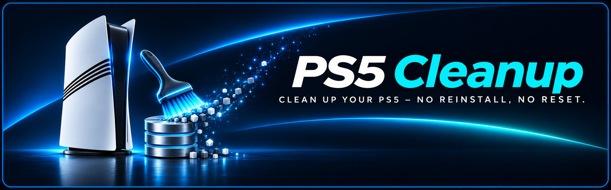
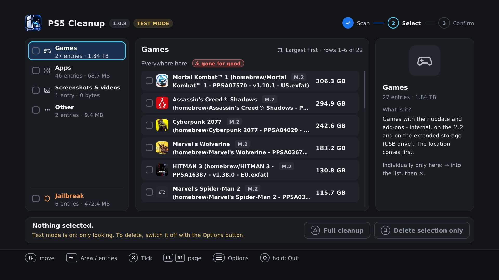
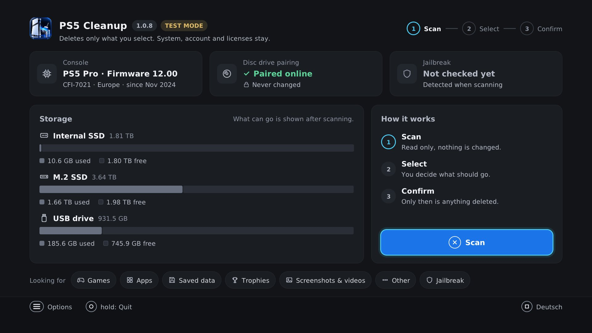
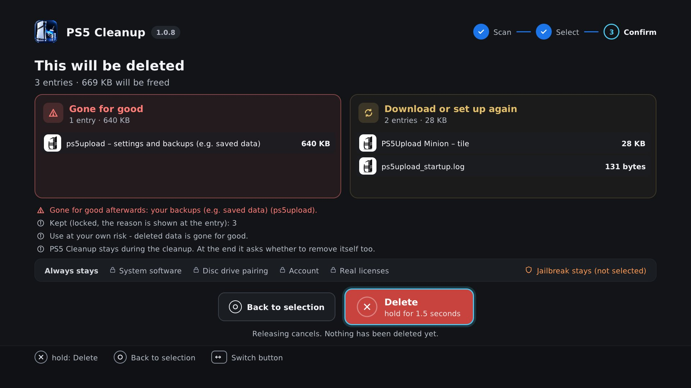
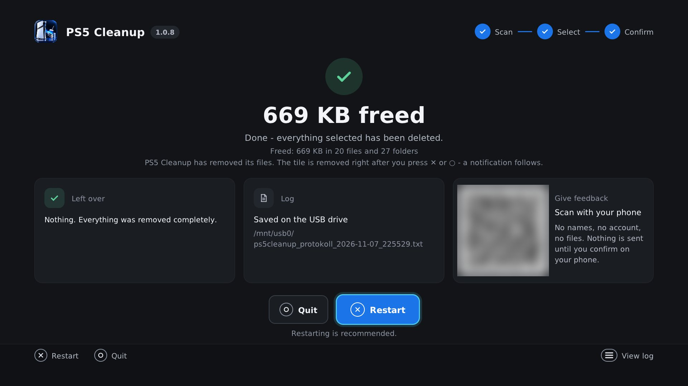
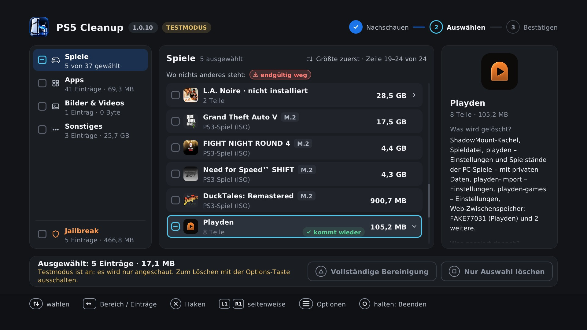
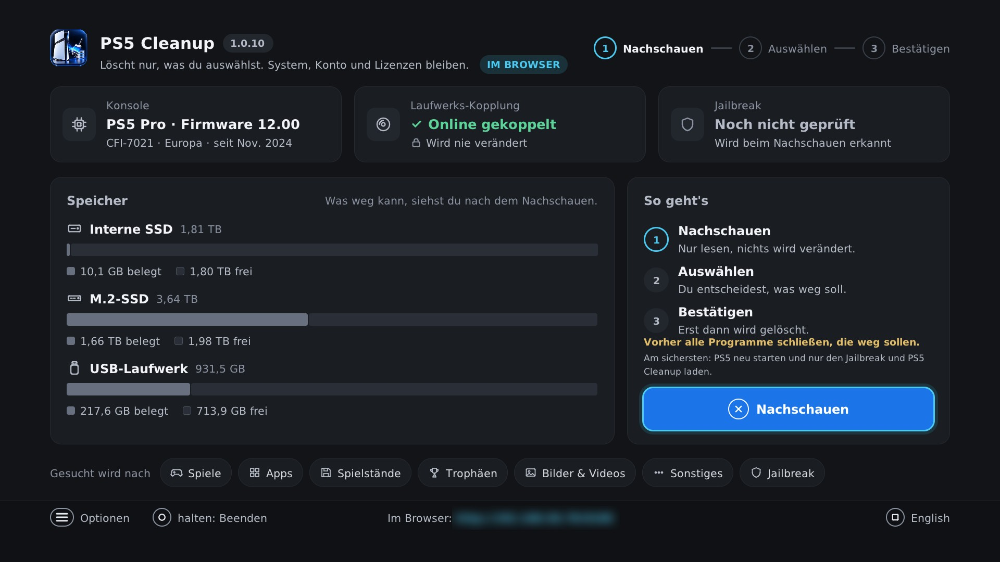
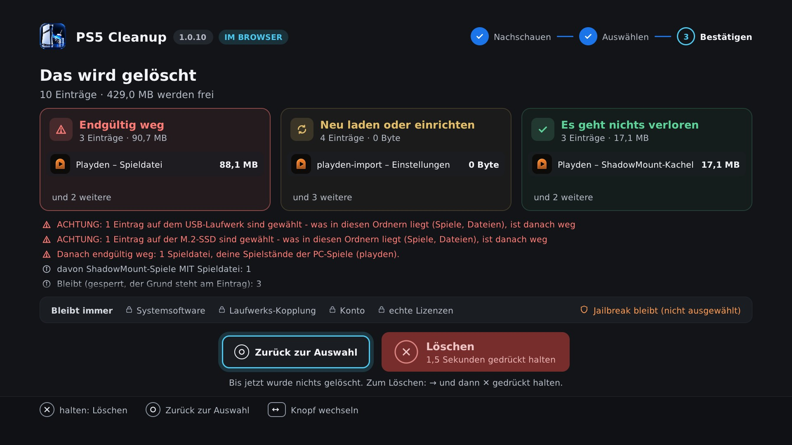
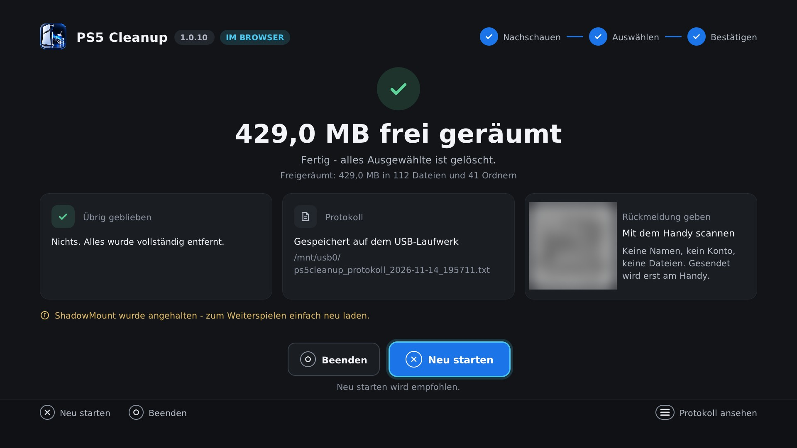

<b>🇬🇧 English</b> (click to expand)

 

**Clean up your PS5 like freshly set up – no reinstall, no reset.**

   

### [⬇️ Download PS5 Cleanup 1.0.10](https://github.com/xXBneutzerNameXx/PS5-Cleanup/releases/latest)

You only need one file: <code>ps5cleanup_v1.0.10.elf</code>. The ZIP contains the same file plus guides and checksums.

[At a glance](#at-a-glance) · [How to use](#how-to-use) · [Feedback](#feedback) · [Community](#community-en)

<b>The selection on your TV:</b> areas on the left, every entry in the middle with its size and a color for what happens afterwards, the explanation on the right.

<b>📸 More screenshots</b> (start, confirm, done – click to expand)

 

<table>
<tr>
<td width="33%"></td>
<td width="33%"></td>
<td width="33%"></td>
</tr>
<tr>
<td><b>Start:</b> Console, firmware, jailbreak, drive pairing and storage at a glance. Scanning changes nothing.</td>
<td><b>Confirm:</b> Before anything happens, it lists exactly what will be deleted and what always stays. Nothing is deleted until you hold ✕.</td>
<td><b>Done:</b> Space freed, log on the USB drive and a QR code for feedback.</td>
</tr>
</table>

The app runs in German and English – switch the language on the start screen.

## What is it?

**PS5 Cleanup** brings a jailbroken PS5 back to a freshly-set-up state – without reinstalling or resetting the system software. It runs **directly on the PS5** (`ps5cleanup_v1.0.10.elf`, own home-screen tile, no PC and no Homebrew Launcher needed, DualSense on your TV – or in a browser on your phone or PC), lists everything with readable names and deletes only what you select – single games, saved data, trophies (e.g. when one game or tool causes problems) or everything at once. Available in **English and German** (follows the PS5 system language; Square switches it before the first scan).

## At a glance

| 🧹 Clean | 🛡️ Safe | 🎮 On your TV or in a browser |
|---|---|---|
| Tiles, apps and games are removed by Sony itself – no empty tiles, no database rebuild | Jailbreak entry points and PS4 games are protected. Nothing is deleted until you confirm | Own home-screen tile, controlled with the controller – or in a browser on your phone or PC. No FTP, no USB drive needed |
| **📦 One block per app** | **🧪 Test mode** | **📱 Feedback via QR code** |
| The tile at the top, everything that belongs to it below – assigned only with evidence, nothing is ever guessed | The app starts in test mode: it shows everything like real deleting and deletes nothing until you switch it off | Scan with your phone, no account, no personal data |

<b>📋 All features in detail</b> (click to expand)

 

**🎮 Controls**

- Control with the DualSense on your TV or in a browser on your phone or PC (home network, no login)
- Dashboard for model, firmware, jailbreak entry points, disc drive pairing and free storage
- Size of every entry shown in the list
- Log any time with Options, saved as a file when deleting
- As its own source in the Payload Manager: Settings → Manage Sources → Add Source, then `https://raw.githubusercontent.com/xXBneutzerNameXx/PS5-Cleanup/main/payloads.json` – new versions arrive there by themselves (idea and template: Strongt1me)

**🧹 Clean deleting**

- One pass is enough – background programs are closed first (FTP server, nanoDNS, Payload Manager and the jailbreak keep running), links from ShadowMount and similar are released cleanly
- Tiles removed via Sony's uninstall service, screenshots and videos via Sony's delete service, saved data together with its entry in the saved data list
- Every game and file on the M.2 listed individually (folders are kept)
- ShadowMount games: tile only or game + tile, ShadowMount+ is stopped cleanly first
- Playden (Steam games): removed together with their entry in Playden's game list; Playden's own data is marked red
- At the end: restart (recommended) or quit

**🔎 Recognising and assigning**

- One block per app and game (tile at the top, everything belonging to it below, assigned only with evidence – ID, name or the app's own program)
- Readable names and tile images in 7 areas, games (PS5, PS4 and PS3 ISO) with update and each DLC selectable separately
- Unknown homebrew apps: their folders are found from their program files – anything only assumed is never ticked automatically

**🛡️ Safety**

- Jailbreak detection and protection (YouTube/Y2JB, Netflix 'N Hack, Lua games, PS2 save jailbreak, offline WebKit jailbreak)
- Scanning and ticking deletes nothing – nothing is deleted until you confirm (delete selection only: hold ✕ for 1.5 seconds, full cleanup: type `DELETE`)
- Test mode at start: look at everything, delete nothing – switch it off in the Options menu

## Requirements

- Jailbroken PS5 with a payload loader or the Payload Manager
- No PC, no FTP and no USB drive needed
- For browser control: a phone or PC in the same home network as the PS5

## How to use

1. Load your jailbreak, start `ps5cleanup_v1.0.10.elf` from the [releases](https://github.com/xXBneutzerNameXx/PS5-Cleanup/releases/latest) with your payload loader or Payload Manager. To use your phone or PC instead, open the address shown at the bottom of the start screen in a browser.
2. *Scan* and look at what was found. The app is in **test mode** and deletes nothing. If the list is right, switch test mode off in the Options menu.
3. Tick entries and Square = *Delete selection only* (hold ✕ for 1.5 seconds to confirm) – or Triangle = *Full cleanup* (type `DELETE`).
4. At the end ✕ *Restart* (recommended) or ○ *Quit*, then start your jailbreak as usual.

> [!WARNING]
> **No "Rebuild Database":** Sony's "Rebuild Database" (Safe Mode) deletes installed **PS4 games from fake PKGs** – they have to be installed again afterwards. With PS5 Cleanup the rebuild is not needed. **Never** choose "Reset PS5" or "Reinstall System Software".

Full guide: [README_EN.txt](README_EN.txt)

<b>✨ New in 1.0.10 – one pass is enough, Playden, PS3 games</b> (click to expand)

 

- **One pass is enough:** what you select is gone after one run – no second pass and no restart in between. This includes tiles that a program still links to a game folder (e.g. ShadowMount, Kraken Mount, PS5Upload) and the empty folders homebrew tiles leave in the system area.
- **Background programs** are closed before deleting so they do not recreate deleted items right away. FTP server, nanoDNS, Payload Manager and the jailbreak keep running. The full cleanup ends with a restart.
- **Playden:** Steam games are recognised and removed together with their entry in Playden's game list. Playden's own data is marked red, because without it Playden no longer starts.
- **More games with name and picture:** PS3 games as ISO and PS5 game files (`.pkg`). Under Games, PS5 comes before PS4 before PS3.
- **Unknown homebrew apps:** PS5 Cleanup reads their program files and finds their folders that way. Anything only assumed is listed in the app's block with its own checkbox and is never ticked automatically.
- **TabShifter and similar:** tiles that a tool entered directly into Sony's list are removed from it specifically. Backups of Sony's app list only go if you tick them yourself.
- **Clear result:** if anything is left over, PS5 Cleanup names it with the reason – and in the log the step at which it failed.
- **Extended error diagnosis (optional):** in the browser control, the cleaned log can be sent along with your feedback (see [Feedback](#feedback)).

Tested on a PS5 Pro (CFI-7021), firmware 12.00, with M.2 and USB drive – selected entries and full cleanup, on the TV and in the browser. Other models and firmwares are not blocked but untested – there, please check in test mode first that the list is right. [All changes](https://github.com/xXBneutzerNameXx/PS5-Cleanup/releases)

## Not touched by the program

System software, disc drive pairing, user account, activation and real licenses, Sony system apps. Nothing is installed or reset. The PS5 app changes Sony's databases only selectively: the entries of deleted saved data, broken add-on information of a game you delete, and tiles that a tool entered directly into Sony's app list (e.g. TabShifter) and that you select for deletion. Each of these changes is checked first and made completely or not at all.

## Privacy

PS5 Cleanup keeps nothing on the PS5 except its own tile and its **logs** (USB drive, otherwise on the PS5) – no settings, no lists, nothing remembered between two starts.

<b>What goes over the network</b> (click to expand)

 

- **Update notice:** at start, PS5 Cleanup asks GitHub (`api.github.com`) once for the latest version number. Only this request is sent – as when opening any website, GitHub sees the internet address. Nothing is downloaded or run, only a version number is accepted. Without internet nothing happens.
- **Browser control:** the page comes from the PS5 itself and only answers devices in the home network. Nothing goes to the internet; nothing stays in the browser except the tile images in its cache (10 minutes at most). Once PS5 Cleanup has quit, the page is gone too.
- **Feedback via QR code:** see [Feedback](#feedback) – the PS5 itself sends nothing.

## Feedback

**Easiest via QR code** – at the end and under Options, "Log & feedback", scan it with your phone and tap "It worked" or "Problem", no account needed. The PS5 sends nothing.

<b>What the feedback contains</b> (click to expand)

 

The link only contains version, edition, build stamp, model number, firmware, drive pairing, jailbreak entry points, connected storage, ShadowMount, numbers per area and, for errors, short error codes (step, kind of entry, location, code) – **no game or app names, no title IDs, no account, no files, no PS5 IP**. The same details are shown in plain text next to it and on your phone; nothing is stored until you tap "Send". As with any website visit, the server briefly sees your phone's internet address – it is not stored. The page runs on Cloudflare at `feedback.ps5cleanup.workers.dev` ([privacy notice](https://feedback.ps5cleanup.workers.dev/datenschutz?l=en)).

**Extended error diagnosis (optional, new in 1.0.10):** if you give feedback from the browser control, you can also send the log on the next page. The checkbox is off at first. The log is cleaned beforehand (IP, e-mail and MAC addresses, user numbers removed), but contains names of games and apps and folder paths of your console. You see all of it before sending.

More detail: via [issues](https://github.com/xXBneutzerNameXx/PS5-Cleanup/issues), [Discussions](https://github.com/xXBneutzerNameXx/PS5-Cleanup/discussions) (model, firmware and result under [Compatibility](https://github.com/xXBneutzerNameXx/PS5-Cleanup/discussions/categories/compatibility)) or on psxtools.de – ideally with the **log**. This also works without deleting anything: in the log view (Options, "Log & feedback"), Square saves it to the USB drive – in test mode too.

### 🗳️ PS5 Cleanup Community – Your Feedback Matters!

**Which PS5 do you own?** Help us improve PS5 Cleanup across different console models and firmware versions!

[**🗳️ Vote in our poll**](https://github.com/xXBneutzerNameXx/PS5-Cleanup/discussions/4) · [**💬 Join discussions**](https://github.com/xXBneutzerNameXx/PS5-Cleanup/discussions) · [**🎮 Report compatibility**](https://github.com/xXBneutzerNameXx/PS5-Cleanup/discussions/categories/compatibility)

## License and thanks

The PS5 app (`1.0.10/`, `ps5cleanup_v1.0.10.elf`) is GPL-3.0-or-later (c) 2026 da_Chris86; the code of the former Windows version is MIT – details and third-party components in [LICENSE.txt](LICENSE.txt).

Thanks to [drakmor](https://github.com/drakmor) (ftpsrv, ps5-hwinfo), [earthonion](https://github.com/earthonion) (ddd_status), John Törnblom (ps5-payload-sdk, ftpsrv), [seregonwar](https://github.com/seregonwar) (zftpd), the makers of ShadowMountPlus and PS5Upload, [Project Nayuki](https://www.nayuki.io/page/qr-code-generator-library) (QR code library) and Markus Scholtes (PS2EXE).

Developed by da_Chris86 with Claude (Anthropic). Independent code review: OpenAI Codex. Idea, requirements and real-console testing by da_Chris86.

**Use at your own risk – deleted data is gone for good.** Unofficial community project, not affiliated with Sony. PlayStation and PS5 are trademarks of Sony Interactive Entertainment Inc.

**Deine PS5 aufräumen wie frisch eingerichtet – ohne Neuinstallation, ohne Zurücksetzen.**

   

### [⬇️ PS5 Cleanup 1.0.10 herunterladen](https://github.com/xXBneutzerNameXx/PS5-Cleanup/releases/latest)

Du brauchst nur eine Datei: <code>ps5cleanup_v1.0.10.elf</code>. Die ZIP enthält dieselbe Datei plus Anleitungen und Prüfsummen.

[Auf einen Blick](#auf-einen-blick) · [So geht's](#so-gehts) · [Rückmeldung](#rückmeldungen) · [Community](#community)

<b>Die Auswahl am Fernseher:</b> links die Bereiche, in der Mitte jeder Eintrag mit Größe und einer Farbe dafür, was danach passiert, rechts die Erklärung. Hier zu sehen: PS3-Spiele und Playden.

<b>📸 Mehr Bilder</b> (Start, Bestätigen, Fertig – zum Aufklappen)

 

<table>
<tr>
<td width="33%"></td>
<td width="33%"></td>
<td width="33%"></td>
</tr>
<tr>
<td><b>Start:</b> Konsole, Firmware, Jailbreak, Laufwerks-Kopplung und Speicher auf einen Blick. Nachschauen ändert nichts.</td>
<td><b>Bestätigen:</b> Vorher steht genau da, was gelöscht wird und was auf jeden Fall bleibt. Gelöscht wird erst, wenn du ✕ gedrückt hältst.</td>
<td><b>Fertig:</b> Freigeräumter Platz, Protokoll auf dem USB-Laufwerk und QR-Code für die Rückmeldung.</td>
</tr>
</table>

## Worum geht's?

Wer seine PS5 mit Jailbreak eine Weile nutzt, kennt das: tote Kacheln, Reste gelöschter Spiele, alte Downloads, Fehlerberichte, Daten von Tools, die man längst nicht mehr nutzt. Die Systemsoftware neu aufspielen will man deswegen aber nicht – erst recht nicht bei Slim und Pro, wo dabei die Laufwerks-Kopplung verloren gehen kann.

**PS5 Cleanup** läuft direkt auf der PS5, listet alles übersichtlich mit Namen auf und löscht nur das, was du auswählst.

**Zwei Wege:**
- **Gezielt** – einzelne Einträge anhaken, z. B. wenn ein Spiel oder Tool Probleme macht: nur dessen Daten, Spielstand oder Trophäen löschen, der Rest bleibt.
- **Vollständige Bereinigung** – alles auf der internen SSD auf einmal, wie frisch eingerichtet (die M.2 wird extra gefragt, Bestätigung mit `LÖSCHEN`).

Beim Start ist der **Testmodus** an: Du kannst alles anschauen, gelöscht wird nichts.

## Auf einen Blick

| 🧹 Sauber | 🛡️ Sicher | 🎮 Am Fernseher oder im Browser |
|---|---|---|
| Kacheln, Apps und Spiele trägt Sony selbst aus – keine leeren Kacheln, kein Datenbank-Neuaufbau | Jailbreak-Einstiege und PS4-Spiele sind geschützt. Gelöscht wird erst nach deiner Bestätigung | Eigene Kachel, Bedienung mit dem Controller – oder im Browser am Handy oder PC. Kein FTP, kein USB-Laufwerk nötig |
| **📦 Ein Block pro App** | **🧪 Testmodus** | **📱 Rückmeldung per QR-Code** |
| Kachel oben, darunter alles, was dazugehört – zugeordnet nur mit Beleg, geraten wird nie | Die App startet im Testmodus: Sie zeigt alles wie beim echten Löschen und löscht nichts, bis du ihn ausschaltest | Mit dem Handy scannen, ohne Konto, ohne persönliche Daten |

<b>📋 Alle Funktionen im Einzelnen</b> (zum Aufklappen)

 

**🎮 Bedienung**

- **Eigene Kachel** auf dem Startbildschirm, Bedienung mit dem Controller am Fernseher – kein PC, kein Homebrew Launcher nötig
- **Bedienung im Browser** am Handy oder PC, im Heimnetz, ohne Anmeldung – dieselbe App, dieselben Bestätigungen
- **Übersicht auf einen Blick:** Modell, Firmware, eingerichtete Jailbreak-Einstiege, Laufwerks-Kopplung und freier Speicher
- **Größe jedes Eintrags direkt in der Liste** (wird im Hintergrund gezählt)
- **Protokoll** jederzeit mit Options; beim Löschen zusätzlich als Datei auf dem USB-Laufwerk, sonst auf der internen Platte oder der M.2
- **Deutsch und Englisch** – richtet sich nach der Systemsprache der PS5, Quadrat schaltet vor dem ersten Nachschauen um
- **Im Payload Manager als eigene Quelle:** Settings → Manage Sources → Add Source, dann `https://raw.githubusercontent.com/xXBneutzerNameXx/PS5-Cleanup/main/payloads.json` – neue Versionen kommen dort von selbst an (Idee und Vorlage: Strongt1me)

**🧹 Sauber löschen**

- **Ein Durchgang reicht** – Programme im Hintergrund werden vorher beendet (FTP-Server, nanoDNS, Payload Manager und der Jailbreak laufen weiter), Verknüpfungen von ShadowMount und Co. sauber gelöst
- **Kacheln verschwinden sauber** über Sonys eigenen Deinstallations-Dienst, **Bilder und Videos** über Sonys Löschdienst, **Spielstände** samt Eintrag in Sonys Spielstand-Liste
- **M.2: jedes Spiel und jede Datei einzeln** – die Ordner selbst bleiben stehen, für M.2 und erweiterten Speicher gibt es eine eigene Rückfrage
- **ShadowMount-Spiele:** wahlweise nur die Kachel oder Spiel samt Kachel – ShadowMount+ wird vorher sauber angehalten
- **Playden (Steam-Spiele):** werden samt Eintrag in Playdens Spieleliste entfernt; Playdens eigene Daten sind rot markiert
- **Am Ende:** ✕ Neu starten (empfohlen) oder ○ Beenden

**🔎 Erkennen und zuordnen**

- **Ein Block pro App und Spiel:** Kachel oben, darunter alles, was dazugehört – zugeordnet nur mit Beleg (Kennung, Name oder das Programm der App selbst)
- **Klarnamen und Kachelbilder** in 7 Bereichen: Spiele (PS5, PS4 und PS3-ISO) mit **Update und DLCs einzeln wählbar**, Apps, Spielstände, Trophäen, Bilder & Videos, Sonstiges, Jailbreak
- **Unbekannte Homebrew-Apps:** ihre Ordner werden aus den Programmdateien erkannt – Vermutetes nie automatisch angehakt

**🛡️ Sicherheit**

- **Jailbreak-Schutz:** YouTube (Y2JB), Netflix ('N Hack), Lua-Spiele, PS2-Spielstand-Jailbreak und offline gespeicherter WebKit-Jailbreak werden erkannt, nie automatisch angehakt und vor dem Löschen deutlich gewarnt
- **Nachschauen und Anhaken löscht nichts** – gelöscht wird erst nach ausdrücklicher Bestätigung (Nur Auswahl: ✕ 1,5 Sekunden halten, vollständige Bereinigung: `LÖSCHEN` eintippen)
- **Testmodus** beim Start: alles anschauen, nichts löschen – im Options-Menü ausschalten

## Voraussetzungen

- PS5 mit Jailbreak und einem Payload-Lader oder dem Payload Manager
- Kein PC, kein FTP und kein USB-Laufwerk nötig
- Für die Bedienung im Browser: Handy oder PC im selben Heimnetz wie die PS5

## So geht's

1. Jailbreak laden, `ps5cleanup_v1.0.10.elf` aus den [Releases](https://github.com/xXBneutzerNameXx/PS5-Cleanup/releases/latest) über den Payload-Lader oder den Payload Manager starten. Steckt ein USB-Laufwerk, kommt das Protokoll darauf. Wer lieber am Handy oder PC bedient, öffnet dort im Browser die Adresse unten auf der Startseite.
2. **Nachschauen** und anschauen, was gefunden wurde. Die App ist im **Testmodus** und löscht nichts. Stimmt die Liste, den Testmodus im Options-Menü ausschalten.
3. Einzelne Einträge anhaken und Quadrat = **Nur Auswahl löschen** (zum Bestätigen ✕ 1,5 Sekunden halten) – oder Dreieck = **Vollständige Bereinigung** (`LÖSCHEN` eintippen).
4. Am Ende **✕ Neu starten** (empfohlen) oder **○ Beenden**. Nach dem Neustart den Jailbreak wie gewohnt starten.

> [!WARNING]
> **Kein „Datenbank neu aufbauen“:** Sonys „Datenbank neu aufbauen“ (abgesicherter Modus) löscht installierte **PS4-Spiele aus Fake-PKGs** – sie müssen danach neu installiert werden. Mit PS5 Cleanup ist der Neuaufbau nicht nötig. **Nie** „PS5 zurücksetzen“ oder „Systemsoftware neu installieren“ wählen.

Ausführliche Anleitung: [LIESMICH.txt](LIESMICH.txt)

<b>✨ Neu in 1.0.10 – ein Durchgang reicht, Playden, PS3-Spiele</b> (zum Aufklappen)

 

- **Ein Durchgang reicht:** Was du auswählst, ist nach einem Lauf weg – ohne zweiten Durchgang und ohne Neustart dazwischen. Das gilt auch für Kacheln, die ein Programm noch mit einem Spielordner verknüpft hat (etwa ShadowMount, Kraken Mount, PS5Upload), und für die leeren Ordner, die Homebrew-Kacheln im Systembereich hinterlassen.
- **Programme im Hintergrund** werden vor dem Löschen beendet, damit sie Gelöschtes nicht sofort wieder anlegen. FTP-Server, nanoDNS, Payload Manager und der Jailbreak laufen weiter. Die vollständige Bereinigung endet mit einem Neustart.
- **Playden:** Steam-Spiele werden erkannt und samt Eintrag in Playdens Spieleliste entfernt. Playdens eigene Daten sind rot markiert, denn ohne sie startet Playden nicht mehr.
- **Mehr Spiele mit Name und Bild:** PS3-Spiele als ISO und PS5-Spieldateien (`.pkg`). Unter Spiele steht PS5 vor PS4 vor PS3.
- **Unbekannte Homebrew-Apps:** PS5 Cleanup liest ihre Programmdateien und findet so ihre Ordner. Was nur vermutet ist, steht im Block der App mit eigenem Haken und wird nie von selbst angehakt.
- **TabShifter und Co.:** Kacheln, die ein Tool direkt in Sonys Liste eingetragen hat, werden gezielt ausgetragen. Sicherungen von Sonys App-Liste gehen nur mit, wenn du sie selbst anhakst.
- **Klares Ergebnis:** Bleibt etwas übrig, nennt PS5 Cleanup es mit Grund – im Protokoll auch den Schritt, an dem es scheiterte.
- **Erweiterte Fehlerdiagnose (freiwillig):** In der Browser-Bedienung lässt sich bei der Rückmeldung das bereinigte Protokoll mitschicken (siehe [Rückmeldungen](#rückmeldungen)).

Getestet auf einer PS5 Pro (CFI-7021) mit Firmware 12.00, M.2 und USB-Laufwerk – gezielt und vollständig, am Fernseher und im Browser. Andere Modelle und Firmwares sind nicht gesperrt, aber noch nicht getestet – dort bitte im Testmodus zuerst schauen, ob die Liste stimmt. [Alle Neuerungen](https://github.com/xXBneutzerNameXx/PS5-Cleanup/releases)

## Was das Programm nicht anfasst

Systemsoftware, Laufwerks-Kopplung, Benutzerkonto, Aktivierung, echte Lizenzen und die Sony-Systemanwendungen. Es wird nichts installiert und nichts zurückgesetzt. Sonys Datenbanken ändert die PS5-App nur gezielt: die Einträge gelöschter Spielstände, kaputte Zusatzinhalt-Angaben eines Spiels, das du löschst, und Kacheln, die ein Tool direkt in Sonys App-Liste eingetragen hat (z. B. TabShifter) und die du zum Löschen auswählst. Jede dieser Änderungen wird vorher geprüft und ganz oder gar nicht gemacht.

## Datenschutz

PS5 Cleanup legt auf der PS5 nichts ab außer seiner eigenen Kachel und seinen **Protokollen** (USB-Laufwerk, sonst auf der PS5) – keine Einstellungen, keine Listen, kein Merken zwischen zwei Starts.

<b>Was dabei ins Netz geht</b> (zum Aufklappen)

 

- **Update-Hinweis:** Beim Start fragt PS5 Cleanup einmal bei GitHub (`api.github.com`) nach der neuesten Versionsnummer. Gesendet wird nur diese Anfrage – wie beim Öffnen einer Webseite sieht GitHub dabei die Internet-Adresse. Geladen oder ausgeführt wird nichts, angenommen wird nur eine Versionsnummer. Ohne Internet passiert nichts.
- **Bedienung im Browser:** Die Seite kommt von der PS5 selbst und antwortet nur Geräten aus dem Heimnetz. Ins Internet geht dabei nichts, im Browser bleibt nichts außer den Kachelbildern im Zwischenspeicher (höchstens 10 Minuten). Sobald PS5 Cleanup beendet ist, ist auch die Seite weg.
- **Rückmeldung per QR-Code:** siehe [Rückmeldungen](#rückmeldungen) – die PS5 selbst sendet dabei nichts.

## Rückmeldungen

**Am einfachsten per QR-Code:** Am Ende und unter Options, „Protokoll & Rückmeldung“ zeigt PS5 Cleanup einen QR-Code. Mit dem Handy scannen, auf „Hat geklappt“ oder „Problem“ tippen – ohne Konto, ohne PC. Die PS5 sendet dabei nichts.

<b>Was in der Rückmeldung steht</b> (zum Aufklappen)

 

Im Link stehen nur Version, Fassung, Bau-Stempel, Modellnummer, Firmware, Laufwerks-Kopplung, eingerichtete Jailbreak-Einstiege, angeschlossene Speicher, ShadowMount, Zahlen je Bereich und bei Fehlern kurze Fehlercodes (Schritt, Art des Eintrags, Ort, Code) – **keine Namen von Spielen oder Apps, keine Spielkennungen, kein Konto, keine Dateien, keine IP der PS5**. Dieselben Angaben stehen in Klartext daneben und noch einmal auf dem Handy; gespeichert wird erst mit „Senden“. Wie bei jedem Webseitenaufruf sieht der Server kurz die Internet-Adresse des Handys – sie wird nicht gespeichert. Die Seite läuft bei Cloudflare unter `feedback.ps5cleanup.workers.dev` ([Datenschutz-Hinweis](https://feedback.ps5cleanup.workers.dev/datenschutz)).

**Erweiterte Fehlerdiagnose (freiwillig, neu in 1.0.10):** Gibst du die Rückmeldung aus der Browser-Bedienung, kannst du auf der nächsten Seite zusätzlich das Protokoll mitschicken. Der Haken ist zuerst aus. Das Protokoll wird vorher bereinigt (IP-, E-Mail- und MAC-Adressen, Benutzer-Nummern entfernt), enthält aber Namen von Spielen und Apps und Ordnerpfade deiner Konsole. Du siehst es vor dem Senden vollständig.

Ausführlicher: Über [Issues](https://github.com/xXBneutzerNameXx/PS5-Cleanup/issues), die [Discussions](https://github.com/xXBneutzerNameXx/PS5-Cleanup/discussions) (Modell, Firmware und Ergebnis gern unter [Compatibility](https://github.com/xXBneutzerNameXx/PS5-Cleanup/discussions/categories/compatibility)) oder auf psxtools.de – am besten mit dem **Protokoll**. Das geht auch ohne etwas zu löschen: In der Protokoll-Ansicht (Options, „Protokoll & Rückmeldung“) speichert Quadrat es auf das USB-Laufwerk – auch im Testmodus.

### 🗳️ PS5 Cleanup Community – Deine Meinung zählt!

**Welche PS5 nutzt du?** Hilf uns, PS5 Cleanup für verschiedene Konsolen und Firmware-Versionen zu verbessern!

[**🗳️ Jetzt abstimmen**](https://github.com/xXBneutzerNameXx/PS5-Cleanup/discussions/4) · [**💬 Diskussionen & Vorschläge**](https://github.com/xXBneutzerNameXx/PS5-Cleanup/discussions) · [**🎮 Kompatibilität melden**](https://github.com/xXBneutzerNameXx/PS5-Cleanup/discussions/categories/compatibility)

## Aufbau

Ordner im Quellcode (zum Aufklappen)

 

| Ordner | Inhalt |
|---|---|
| `1.0.10/kern/` | Kern der PS5-App: Schutzliste, Suche, Löschen, Abläufe |
| `1.0.10/app/` | Oberfläche am Fernseher (SDL2, DualSense), Bedienung im Browser (`fern.c`, `fern_seite.html`) und PS5-Anbindung (Sony-Deinstallation, Löschdienst, Spielstand-Liste) |
| `1.0.10/start/` | `ps5cleanup.elf`: Start, eigene Kachel (PSCL00001), Hintergrundteil für Selbstentfernung und Neustart |
| `1.0.10/db/` | Prüfung von Sonys Datenbanken (SQLite) |
| `1.0.10/rueckmeldung/` | Handy-Seite für die Rückmeldung per QR-Code (Cloudflare Worker) |
| `1.0.10/test/` | Tests am PC |
| `1.0.10/fremd/` | Anleitung und Skript für die fremden Bibliotheken (PCRE2, cJSON) |
| `Quellcode/` | die bisherige Windows-Fassung 1.0.6 (C#) und ältere Fassungen – nicht mehr weiterentwickelt |

## Lizenz

Die PS5-App (`1.0.10/`, `ps5cleanup_v1.0.10.elf`) steht unter der GPL-3.0 (oder später) – Copyright (c) 2026 da_Chris86. Der Code der bisherigen Windows-Fassung steht unter MIT. Details und Bestandteile anderer Urheber in [LICENSE.txt](LICENSE.txt).

## Danke an

[drakmor](https://github.com/drakmor) (ftpsrv, ps5-hwinfo), [earthonion](https://github.com/earthonion) (ddd_status), John Törnblom (ps5-payload-sdk, ftpsrv), [seregonwar](https://github.com/seregonwar) (zftpd), die Macher von ShadowMountPlus und PS5Upload, [Project Nayuki](https://www.nayuki.io/page/qr-code-generator-library) (QR-Code-Bibliothek) sowie Markus Scholtes (PS2EXE).

Entwickelt von da_Chris86 mit Claude (Anthropic). Unabhängige Code-Prüfung: OpenAI Codex. Idee, Vorgaben und die Tests an der echten Konsole kommen von mir.

**Benutzung auf eigene Gefahr – Gelöschtes ist endgültig weg.**
Inoffizielles Community-Projekt, keine Verbindung zu Sony. PlayStation und PS5 sind Marken von Sony Interactive Entertainment Inc.
