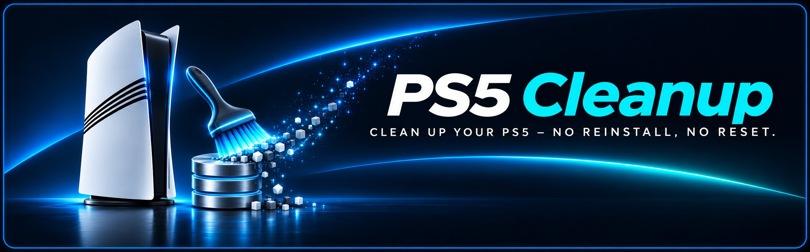
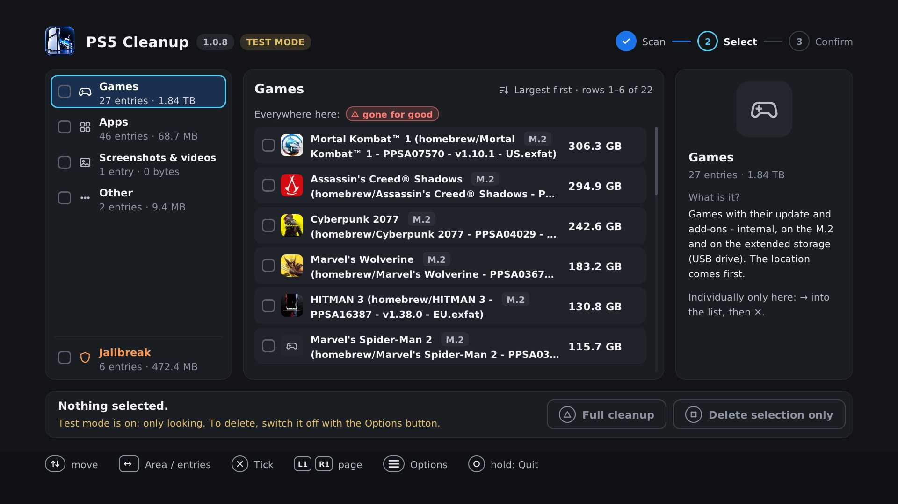
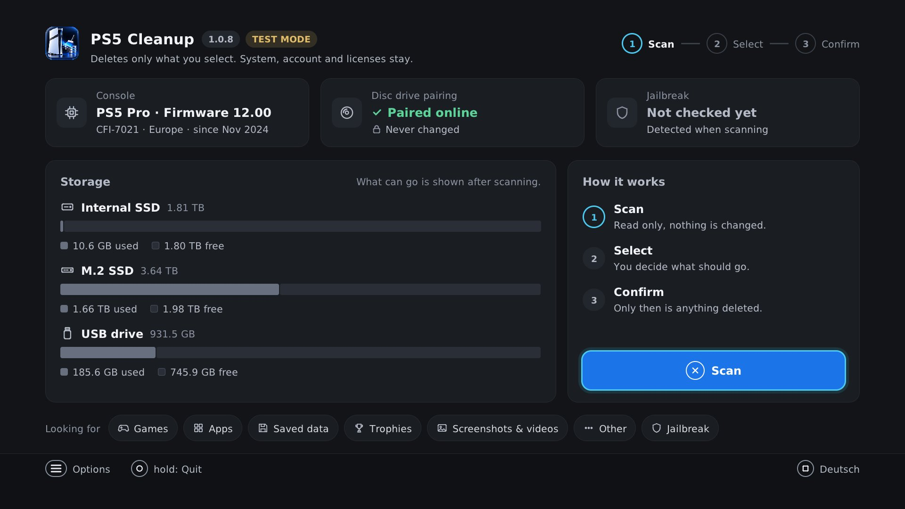
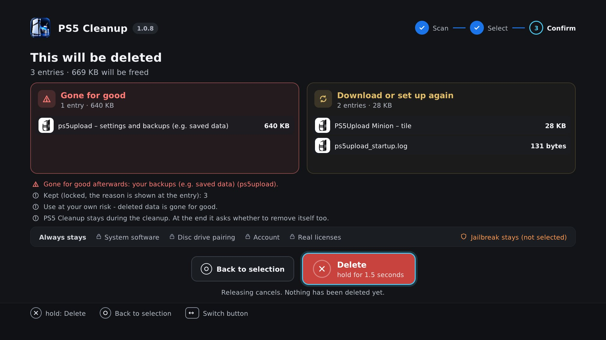
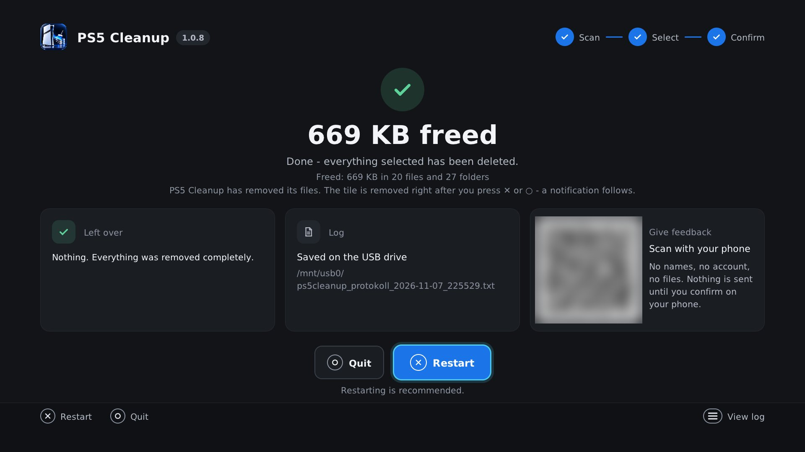

[🇩🇪 Deutsch](README.md) · **🇬🇧 English**

**Clean up your PS5 like freshly set up – no reinstall, no reset.**

   

### [⬇️ Download PS5 Cleanup 1.0.10](https://github.com/xXBneutzerNameXx/PS5-Cleanup/releases/latest)

You only need one file: <code>ps5cleanup_v1.0.10.elf</code>. The ZIP contains the same file plus guides and checksums.

[At a glance](#at-a-glance) · [How to use](#how-to-use) · [Feedback](#feedback) · [Community](#community)

<b>The selection on your TV:</b> areas on the left, every entry in the middle with its size and a color for what happens afterwards, the explanation on the right.

<b>📸 More screenshots</b> (start, confirm, done – click to expand)

 

<table>
<tr>
<td width="33%"></td>
<td width="33%"></td>
<td width="33%"></td>
</tr>
<tr>
<td><b>Start:</b> Console, firmware, jailbreak, drive pairing and storage at a glance. Scanning changes nothing.</td>
<td><b>Confirm:</b> Before anything happens, it lists exactly what will be deleted and what always stays. Nothing is deleted until you hold ✕.</td>
<td><b>Done:</b> Space freed, log on the USB drive and a QR code for feedback.</td>
</tr>
</table>

The app runs in German and English – switch the language on the start screen.

## What is it?

**PS5 Cleanup** brings a jailbroken PS5 back to a freshly-set-up state – without reinstalling or resetting the system software. It runs **directly on the PS5** (`ps5cleanup_v1.0.10.elf`, own home-screen tile, no PC and no Homebrew Launcher needed, DualSense on your TV – or in a browser on your phone or PC), lists everything with readable names and deletes only what you select – single games, saved data, trophies (e.g. when one game or tool causes problems) or everything at once. Available in **English and German** (follows the PS5 system language; Square switches it before the first scan).

## At a glance

| 🧹 Clean | 🛡️ Safe | 🎮 On your TV or in a browser |
|---|---|---|
| Tiles, apps and games are removed by Sony itself – no empty tiles, no database rebuild | Jailbreak entry points and PS4 games are protected. Nothing is deleted until you confirm | Own home-screen tile, controlled with the controller – or in a browser on your phone or PC. No FTP, no USB drive needed |
| **📦 One block per app** | **🧪 Test mode** | **📱 Feedback via QR code** |
| The tile at the top, everything that belongs to it below – assigned only with evidence, nothing is ever guessed | The app starts in test mode: it shows everything like real deleting and deletes nothing until you switch it off | Scan with your phone, no account, no personal data |

<b>📋 All features in detail</b> (click to expand)

 

**🎮 Controls**

- Control with the DualSense on your TV or in a browser on your phone or PC (home network, no login)
- Dashboard for model, firmware, jailbreak entry points, disc drive pairing and free storage
- Size of every entry shown in the list
- Log any time with Options, saved as a file when deleting
- As its own source in the Payload Manager: Settings → Manage Sources → Add Source, then `https://raw.githubusercontent.com/xXBneutzerNameXx/PS5-Cleanup/main/payloads.json` – new versions arrive there by themselves (idea and template: Strongt1me)

**🧹 Clean deleting**

- One pass is enough – background programs are closed first (FTP server, nanoDNS, Payload Manager and the jailbreak keep running), links from ShadowMount and similar are released cleanly
- Tiles removed via Sony's uninstall service, screenshots and videos via Sony's delete service, saved data together with its entry in the saved data list
- Every game and file on the M.2 listed individually (folders are kept)
- ShadowMount games: tile only or game + tile, ShadowMount+ is stopped cleanly first
- Playden (Steam games): removed together with their entry in Playden's game list; Playden's own data is marked red
- At the end: restart (recommended) or quit

**🔎 Recognising and assigning**

- One block per app and game (tile at the top, everything belonging to it below, assigned only with evidence – ID, name or the app's own program)
- Readable names and tile images in 7 areas, games (PS5, PS4 and PS3 ISO) with update and each DLC selectable separately
- Unknown homebrew apps: their folders are found from their program files – anything only assumed is never ticked automatically

**🛡️ Safety**

- Jailbreak detection and protection (YouTube/Y2JB, Netflix 'N Hack, Lua games, PS2 save jailbreak, offline WebKit jailbreak)
- Scanning and ticking deletes nothing – nothing is deleted until you confirm (delete selection only: hold ✕ for 1.5 seconds, full cleanup: type `DELETE`)
- Test mode at start: look at everything, delete nothing – switch it off in the Options menu

## Requirements

- Jailbroken PS5 with a payload loader or the Payload Manager
- No PC, no FTP and no USB drive needed
- For browser control: a phone or PC in the same home network as the PS5

## How to use

1. Load your jailbreak, start `ps5cleanup_v1.0.10.elf` from the [releases](https://github.com/xXBneutzerNameXx/PS5-Cleanup/releases/latest) with your payload loader or Payload Manager. To use your phone or PC instead, open the address shown at the bottom of the start screen in a browser.
2. *Scan* and look at what was found. The app is in **test mode** and deletes nothing. If the list is right, switch test mode off in the Options menu.
3. Tick entries and Square = *Delete selection only* (hold ✕ for 1.5 seconds to confirm) – or Triangle = *Full cleanup* (type `DELETE`).
4. At the end ✕ *Restart* (recommended) or ○ *Quit*, then start your jailbreak as usual.

> [!WARNING]
> **No "Rebuild Database":** Sony's "Rebuild Database" (Safe Mode) deletes installed **PS4 games from fake PKGs** – they have to be installed again afterwards. With PS5 Cleanup the rebuild is not needed. **Never** choose "Reset PS5" or "Reinstall System Software".

Full guide: [README_EN.txt](README_EN.txt)

<b>✨ New in 1.0.10 – one pass is enough, Playden, PS3 games</b> (click to expand)

 

- **One pass is enough:** what you select is gone after one run – no second pass and no restart in between. This includes tiles that a program still links to a game folder (e.g. ShadowMount, Kraken Mount, PS5Upload) and the empty folders homebrew tiles leave in the system area.
- **Background programs** are closed before deleting so they do not recreate deleted items right away. FTP server, nanoDNS, Payload Manager and the jailbreak keep running. The full cleanup ends with a restart.
- **Playden:** Steam games are recognised and removed together with their entry in Playden's game list. Playden's own data is marked red, because without it Playden no longer starts.
- **More games with name and picture:** PS3 games as ISO and PS5 game files (`.pkg`). Under Games, PS5 comes before PS4 before PS3.
- **Unknown homebrew apps:** PS5 Cleanup reads their program files and finds their folders that way. Anything only assumed is listed in the app's block with its own checkbox and is never ticked automatically.
- **TabShifter and similar:** tiles that a tool entered directly into Sony's list are removed from it specifically. Backups of Sony's app list only go if you tick them yourself.
- **Clear result:** if anything is left over, PS5 Cleanup names it with the reason – and in the log the step at which it failed.
- **Extended error diagnosis (optional):** in the browser control, the cleaned log can be sent along with your feedback (see [Feedback](#feedback)).

Tested on a PS5 Pro (CFI-7021), firmware 12.00, with M.2 and USB drive – selected entries and full cleanup, on the TV and in the browser. Other models and firmwares are not blocked but untested – there, please check in test mode first that the list is right. [All changes](https://github.com/xXBneutzerNameXx/PS5-Cleanup/releases)

## Not touched by the program

System software, disc drive pairing, user account, activation and real licenses, Sony system apps. Nothing is installed or reset. The PS5 app changes Sony's databases only selectively: the entries of deleted saved data, broken add-on information of a game you delete, and tiles that a tool entered directly into Sony's app list (e.g. TabShifter) and that you select for deletion. Each of these changes is checked first and made completely or not at all.

## Privacy

PS5 Cleanup keeps nothing on the PS5 except its own tile and its **logs** (USB drive, otherwise on the PS5) – no settings, no lists, nothing remembered between two starts.

<b>What goes over the network</b> (click to expand)

 

- **Update notice:** at start, PS5 Cleanup asks GitHub (`api.github.com`) once for the latest version number. Only this request is sent – as when opening any website, GitHub sees the internet address. Nothing is downloaded or run, only a version number is accepted. Without internet nothing happens.
- **Browser control:** the page comes from the PS5 itself and only answers devices in the home network. Nothing goes to the internet; nothing stays in the browser except the tile images in its cache (10 minutes at most). Once PS5 Cleanup has quit, the page is gone too.
- **Feedback via QR code:** see [Feedback](#feedback) – the PS5 itself sends nothing.

## Feedback

**Easiest via QR code** – at the end and under Options, "Log & feedback", scan it with your phone and tap "It worked" or "Problem", no account needed. The PS5 sends nothing.

<b>What the feedback contains</b> (click to expand)

 

The link only contains version, edition, build stamp, model number, firmware, drive pairing, jailbreak entry points, connected storage, ShadowMount, numbers per area and, for errors, short error codes (step, kind of entry, location, code) – **no game or app names, no title IDs, no account, no files, no PS5 IP**. The same details are shown in plain text next to it and on your phone; nothing is stored until you tap "Send". As with any website visit, the server briefly sees your phone's internet address – it is not stored. The page runs on Cloudflare at `feedback.ps5cleanup.workers.dev` ([privacy notice](https://feedback.ps5cleanup.workers.dev/datenschutz?l=en)).

**Extended error diagnosis (optional, new in 1.0.10):** if you give feedback from the browser control, you can also send the log on the next page. The checkbox is off at first. The log is cleaned beforehand (IP, e-mail and MAC addresses, user numbers removed), but contains names of games and apps and folder paths of your console. You see all of it before sending.

More detail: via [issues](https://github.com/xXBneutzerNameXx/PS5-Cleanup/issues), [Discussions](https://github.com/xXBneutzerNameXx/PS5-Cleanup/discussions) (model, firmware and result under [Compatibility](https://github.com/xXBneutzerNameXx/PS5-Cleanup/discussions/categories/compatibility)) or on psxtools.de – ideally with the **log**. This also works without deleting anything: in the log view (Options, "Log & feedback"), Square saves it to the USB drive – in test mode too.

### 🗳️ PS5 Cleanup Community – Your Feedback Matters!

**Which PS5 do you own?** Help us improve PS5 Cleanup across different console models and firmware versions!

[**🗳️ Vote in our poll**](https://github.com/xXBneutzerNameXx/PS5-Cleanup/discussions/4) · [**💬 Join discussions**](https://github.com/xXBneutzerNameXx/PS5-Cleanup/discussions) · [**🎮 Report compatibility**](https://github.com/xXBneutzerNameXx/PS5-Cleanup/discussions/categories/compatibility)

## License and thanks

The PS5 app (`1.0.10/`, `ps5cleanup_v1.0.10.elf`) is GPL-3.0-or-later (c) 2026 da_Chris86; the code of the former Windows version is MIT – details and third-party components in [LICENSE.txt](LICENSE.txt).

Thanks to [drakmor](https://github.com/drakmor) (ftpsrv, ps5-hwinfo), [earthonion](https://github.com/earthonion) (ddd_status), John Törnblom (ps5-payload-sdk, ftpsrv), [seregonwar](https://github.com/seregonwar) (zftpd), the makers of ShadowMountPlus and PS5Upload, [Project Nayuki](https://www.nayuki.io/page/qr-code-generator-library) (QR code library) and Markus Scholtes (PS2EXE).

Developed by da_Chris86 with Claude (Anthropic). Independent code review: OpenAI Codex. Idea, requirements and real-console testing by da_Chris86.

**Use at your own risk – deleted data is gone for good.** Unofficial community project, not affiliated with Sony. PlayStation and PS5 are trademarks of Sony Interactive Entertainment Inc.
